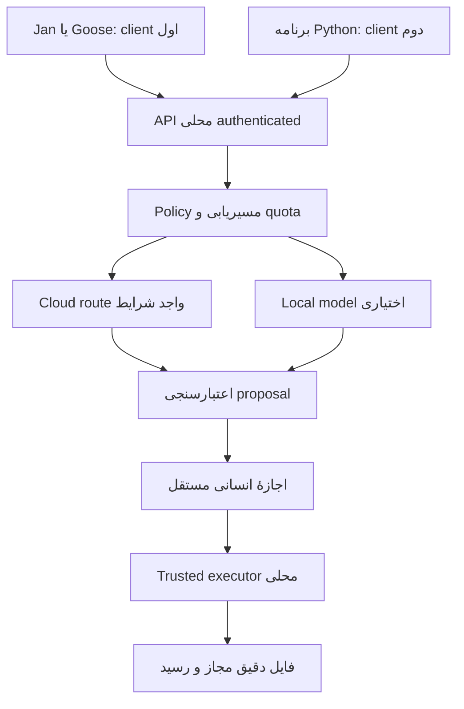

# WA0011 — Cloud-First تحت کنترل محلی، سهمیهٔ واقعی و مسیریابی واجد شرایط

تاریخ پژوهش: 2026-10-22 (Asia/Tehran). مأموریت WQ0011، همان پروژه و TASK-0017؛ TASK-0023 فقط پژوهش. مقصد یگانه: `mohammadrezanabizadeh41-png/DJMRN-Intelligent-Assistant` / `main` / `04-work-research-bridge/responses/WA0011.md`.

**وضعیت پژوهش: PARTIAL / THREE EVIDENCE LEGS ACTUALLY READ / CONDITIONAL DESIGN ONLY.** هر سه مسیر واقعاً استفاده شدند، اما دسترسی قانونی قابل اتکا برای کاربر ایران، موجودی واقعی حساب، چند قرارداد upstream و برخی جزئیات محصول/Windows هنوز اثبات نشده‌اند. این وضعیت به معنی فقدان یکی از سه مسیر نیست؛ به معنی کامل نبودن شواهد برای توصیهٔ فعال‌سازی است. **D-005 باز، G3B بسته، هیچ stack یا provider تصویب نشده است.**

ثبت همین سند تنها write مجاز است. هیچ نصب، inference/API مصرفی، حساب، کلید، پرداخت، دانلود باینری/مدل، اجرای dependency، Windows diagnostic، deploy، تغییر Notion/کد/آزمون/ledger انجام نشد. Commit/blob خود این گزارش: PENDING UNTIL PERSISTENCE؛ رسید واقعی پس از ثبت در پیام نهایی می‌آید، چون درج SHA خود فایل در همان فایل آن را تغییر می‌دهد.

## 1. EXECUTIVE_DECISION_BRIEF

**Judgment:** Cloud-First / locally controlled جهت پژوهشی مناسبی برای محدودیت دستگاه است؛ اما «همیشه رایگان + مدل قوی + ایران + بدون کار دستی» هنوز یک قابلیت اثبات‌شده نیست. مانع نخست انتخاب router نیست: باید حداقل یک مسیر مدل با حق استفاده، هزینهٔ صفر، privacy و قابلیت کافی واجد شرایط شود. در حال حاضر هیچ مسیر end-to-end برای این کاربر APPROVED/VERIFIED-OPERATIONAL نیست.

پاسخ به «آیا برنامه‌های فعلی کافی‌اند؟»: **PARTIAL**. Jan و Goose می‌توانند client یک API ابری سازگار باشند؛ برای یک گفت‌وگوی فارسی با یک provider واجد شرایط، احتمالاً Gateway جدید لازم نیست. اما شواهد حاضر نشان نمی‌دهد برنامه‌های نصب‌شده دفتر سهمیهٔ مشترک پایدار، تشخیص reset معتبر، سقف اتمیک بین دو برنامه، failover مطابق capability و بازیابی بدون تکرار action را یکجا فراهم می‌کنند. Python یک زبان موجود است؛ وجودش مساوی router آماده نیست. Ollama/LM Studio/llama.cpp عمدتاً serving/lifecycle محلی‌اند. KYNXA gateway داخلی دارد ولی کفایت آن برای این قرارداد ثابت نشده است.

ترتیب کمینهٔ پیشنهادی، فقط برای بررسی هماهنگ‌کننده:

1. پیش از ساخت، حل eligibility/privacy/free quota یک provider و یک model ID؛ اگر حل نشد STOP.
2. یک UI موجود با ابزارهای عمومی خاموش → یک مدل pin‌شده → فقط دادهٔ ساختگی غیرحساس و پاسخ متنی، پس از مجوز مستقل. این baseline بدون Gateway معیار کیفیت و latency می‌دهد.
3. تنها با نیاز واقعی دو client/دو provider، یک endpoint محلی مشترک. Bifrost و LiteLLM گزینه‌های جدی بررسی بعدی‌اند؛ freellmpool گزینهٔ سبک‌تر تازه، با HOLDهای روشن. انتخاب هیچ‌یک در این گزارش انجام نمی‌شود.
4. CAP-006 و مرجع اجازهٔ فایل مستقل بمانند؛ عوض شدن مدل اختیار فایل/PowerShell/ایمیل را تغییر ندهد. مدل محلی اختیاری است؛ اگر ضعیف یا RAM ناکافی بود graceful stop بهتر از downgrade پنهان است.

یافته‌های تعیین‌کننده: OpenRouter free محدودیت مشترک حساب دارد؛ مدل گردانی سهمیهٔ جدید ایجاد نمی‌کند. Cerebras فعلی trial کارت‌محور است، HF Free اعتبار ماهانه ندارد و GitHub Models بازنشسته است. AvalAI و 1xAi هدیهٔ ثبت‌نام دارند، نه API رایگان تجدیدپذیرِ ثابت‌شده. Gisoo تعرفهٔ مصرفی دارد. مهم‌تر، ابزارها ممکن است retry/rotation پیش‌فرضی داشته باشند که با DJMRN سازگار نیست؛ «fallback موجود» با «سیاست امن آماده» یکی نیست. منابع و حدود هر ادعا در ماتریس‌های پایین آمده‌اند.

## 2. APPLIED_LIBRARY_READ_RECEIPT

صفحات زیر از اتصال زندهٔ Notion واقعاً fetch شدند؛ زمان‌های last-edited پاسخ سرویس UTC هستند. `verification.state=unverified` در Notion یک وضعیت بومی صفحه است، نه دلیل ساختگی دانستن محتوای آن. در metadata دریافتی truncated/unknown-block-count صریح ارائه نشد؛ فقدان آن را false/zero فرض نکردم.

| صفحه | نسخه/زمان مشاهده‌شده | پوشش واقعی |
|---|---|---|
| [Operating Memory](https://app.notion.com/p/3edc8c684690814a9707cb880534f462) | 2026-10-20T16:48:30.778Z | قواعد پیش‌کار، مرجع پروژهٔ جدید، research-first، هزینه/اجازه؛ سوابق متناقض قدیمی «repo هنوز ساخته نشده» زیر update جدید، تاریخی‌اند |
| [Tool Governance](https://app.notion.com/p/3edc8c68469081cc90abdd5183f1bdb1) | 2026-10-17T16:40:34.103Z | need-first، composition، هزینه UNKNOWN/DENY، نصب هنگام نیاز، تفکیک source/runtime/state، بدون انتقال authority |
| [Applied Capability Index](https://app.notion.com/p/3fdc8c684690817a9b5acef3c108253f) | عنوان v0.48؛ 2026-10-20T17:01:05.277Z؛ 652,008 نویسهٔ text برگشتی | اصلاح جهت catalog-first، شاخه‌های model/runtime/cloud، اشاره LiteLLM و اصلاح free/trial؛ نه ممیزی همهٔ 17 شاخه |
| [Applied Mission](https://app.notion.com/p/3fdc8c6846908167a77feab9564dc66d) | 2026-10-20T17:08:47.939Z؛ 237,155 نویسه | greenfield، discovery پیش از implementation، پژوهش مستقل از ابزار نصب‌شده |
| [General Living Research](https://app.notion.com/p/3fbc8c684690817d8c94cce0bfaa1a59) | Discovery054/v52 طبق checkpoint؛ 2026-10-18T15:00:07.265Z؛ 1,384,259 نویسه | R016 Candidate11 LiteLLM و LocalAI، R018 Groq/OpenRouter/WorkersAI/Gemini، R021 HF/Cerebras/GitHubModels/Mistral و summary corrections |

دریافت متن بزرگ مساوی خواندن معنایی همهٔ آن نیست: جست‌وجوی درون متن و خواندن بخش‌های مرتبط انجام شد. R016 توضیح می‌دهد LiteLLM SDK/gateway است، نه مدل یا هماهنگ‌کنندهٔ agent؛ رایگان بودن کد اعتبار مدل نمی‌سازد. R018 quotaها و منطقه را باز گذاشته است. R021 همین اواخر HF بدون credit، Cerebras trial و GitHub retirement را تصحیح کرده؛ بنابراین پژوهش حاضر این‌ها را دوباره «کشف جدید» حساب نمی‌کند و فقط منابع زندهٔ تعیین‌کننده را refresh می‌کند.

جست‌وجوی literal (case-insensitive) در سه متن برگشتی: LiteLLM در Index/General موجود؛ Portkey/Bifrost/freerouter/freellmpool/Gisoo/AvalAI/1xAi هیچ match انگلیسی در این سه متن نداشتند. این **فقدان در scope متنی** است، نه اثبات نبود alias فارسی یا تمام صفحات workspace. No Notion write.

یک نکتهٔ حاکمیتی: قاعدهٔ اختصاص provider برای هر «search boundary» در Tool Governance دربارهٔ Search API است؛ مجوز pooling inference نیست و ممنوعیت کلی inference pooling هم از آن استنباط نمی‌شود. API مشترک پیشنهادی صرفاً در یک حساب/سازمان قانونی و با هویت/بودجهٔ مستقل appها قابل بررسی است؛ سهمیهٔ provider مشترک دوباره‌شماری نمی‌شود.

## 3. PROJECT_REPOSITORY_READ_RECEIPT

GitHub connected `get_repo` واقعی: id=1427268660، full identity مطابق مقصد، private، default_branch=main، archived=false، push=true. HEAD مبنای پژوهش:
`0d60b52752f1b6f32facb0352497f3af8d970663`.
recursive tree همان commit: truncated=false؛ WA0011 وجود نداشت؛ هیچ AGENTS.md در tree مشاهده نشد. fetch مستقیم WA0011 در main نیز 404 داد؛ collision اثبات نشد. فقط create-new مجاز است و پیش از write دوباره چک می‌شود.

| سند واقعاً دریافت‌شده | Git blob |
|---|---|
| WQ0011، متن کامل | 29f7b16e4d17c737c89a9506a54a759b247ad3f8 |
| PROJECT-RULES | 078d043088103729863384e681d66eb2c05221a9 |
| REPOSITORY-LOCK | 231778be56580deedcd1d5c0c5de54bc093552fc |
| Work README | fa5fdf56ad50714e6e4479fe5111ec6f1036be27 |
| README | 9542455721cb4872a487841eac9d2cb0cdde314d |
| CURRENT-STATUS | 7f48fe93567bff306d67c0187ce5cecbb4ab2b84 |
| DECISION-REGISTER | aa3f26226228aece68aff04866716005a27fa5ba |
| TASK-REGISTER | d5f88f5ea9bd952564513dfea1fcbeb72c4d5e39 |
| MASTER-SYSTEM-ROADMAP | 1dc1909d102f1cd8691ea79d712a97bd9549edc3 |
| KB INDEX | 8ef55004955f112427c9de3246564ff2efe45804 |
| SOURCE-REGISTER | 8ed89a1c488289bacc1d12fc7ff3a873ec0c7fb1 |
| WA0010 | e754f097c295a80cd622d2efb2f7db860c5b1060 |
| WQ0010 review | ab8691f5a11ecf6b41487ca0756e149d5a69bd57 |
| LOCAL-ENGINE-AND-MODEL-PATH-REGISTER.md | 0c5a4ccfa581af54aad49ae45f9b6f777be34fcd |
| KYNXA-H3-PARKED-AUTOMATION-CRITERION-20261022.md | 46fb685bd0e743ca38099c6ac700f3ac3cc99cb3 |
| GOOSE-G4-GEMMA1B-PERSIAN-SELF-INTRO-QUALITY-FAIL-20261022.md | 59386fa341c52e7e590599ce92e95970885c29c7 |
| FUTURE-INFERENCE-PLANE-RESEARCH-REQUIREMENT.md (INF-001) | 555197237262f9ec8beffd787cb5769f8295feb6 |

قوانین، درخواست، تصمیم‌ها و شواهد خاص مأموریت خوانده شدند؛ CURRENT فقط بخش canonical پیش از تاریخچه مبناست. Roadmap/task/source/index و WA0010 به‌صورت بخش‌های مرتبط مرور شدند، نه ممیزی سطر به سطر همهٔ تاریخچه. فایل‌های آغازین با main و بقیه در SHA ثابت دریافت شدند؛ tree همان SHA برای تثبیت هویت blobها استفاده می‌شود. اسناد قبلی مخزن Research-Bridge و djmrn تغییر نکردند و این اجرا آن‌ها را مستقیم نخواند؛ پیشینهٔ مرتبط از کتابخانه/همین پروژه کافی بود.

تطبیق: D-003 free-first؛ D-005 NOT DECIDED؛ D-009 capability-first؛ D-014 chat-led؛ D-015 دو سطح گفتگو و قرارداد ابزار مشترک، نه API آمادهٔ ChatGPT Plus. INF-001 از قبل assistant/model/engine/provider/router/tool-permission را جدا کرده؛ به registry یا پروژهٔ دوم نیاز نیست. WQ0011 تنها اولویت پژوهش آن را Cloud-First می‌کند.

WA0010 و review پیشین مجوز فایل و reopen-by-path/TOCTOU را باز گذاشته‌اند. شواهد جدید G3B در CURRENT به معنی رفع همهٔ holdها نیست. CAP-006 جست‌وجوی قطعی قابل استفادهٔ مجدد است؛ cloud routing نباید guard بسته را باز کند.

**USER-OBSERVED:** KYNXA1.7.0 نصب/GUI داشت و Gemma1B waiting-resource؛ علت admission محتمل بود نه خرابی فایل اثبات‌شده. Goose واقعاً متن فارسی تولید کرد ولی self-introduction نامنسجم بود؛ reliable tool calling آزموده نشد. inventory قدیمی‌تر می‌گوید Goose NOT_INSTALLED، ولی فایل جدید G4 و CURRENT شاهد متأخر استفاده است؛ آن ردیف قدیمی را وضعیت امروز نمی‌گیرم. هیچ نتیجه‌ای دربارهٔ ناتوانی همهٔ مدل‌های محلی یا نسخهٔ فعلی Jan از این آزمون استنتاج نمی‌شود.

## 4. INDEPENDENT_SEARCH_RECEIPT

تاریخ مراجعهٔ منابع بیرونی: 2026-10-22. ابتدا queryهای فناوری‌خنثی:
- `lightweight OpenAI compatible multi provider gateway free quota routing Windows fallback`
- `LLM gateway automatic recovery capability routing free tier proxy alternative`

سپس queryهای مستقل publisher/identity و رسمی: freerouter LLM license؛ Windows Bifrost gateway؛ LiteLLM routing/virtual keys؛ Portkey OSS budget؛ Groq rate-limits/legal؛ OpenRouter limits/terms؛ Workers AI neurons/data؛ Gemini regions؛ API گیسو/AvalAI/1xAi؛ API رایگان ایران/لیارا. دو موتور جست‌وجو استفاده شد؛ نتیجهٔ search را برای ادعاهای کلیدی با صفحهٔ رسمی، GitHub واقعی، README/manifest/LICENSE و برخی sourceها تطبیق دادم. هیچ login، API key inspection یا request مدل انجام نشد.

نامزد تازهٔ مستقل مهم: **0xzr/freellmpool**؛ Python>=3.11 و فقط httpx به‌عنوان dependency مستقیم در pyproject نسخه v0.13.0؛ Beta/OS-independent/Python3.14 classifier. این با «stdlib-only» یا «Windows-tested» یکسان نیست. source router خوانده/نمونه‌برداری شد؛ health errorها، cooldown و quota-account جدا دارد ولی چارچوب سیاست کامل DJMRN هنوز ندارد.

نتایج دیگری مثل Ficelle، Hadrian، LLMGateway، freeway، FreeLLM-Gateway و free-llm-proxy-router در کشف اولیه آمدند. ادعاهای «هیچ‌وقت سهمیه تمام نمی‌شود»/اعداد میلیاردی و split-tunnel/key rotation مبنای توصیه نشدند. این نام‌ها NEW-EXTERNAL/DISCOVERY-ONLY هستند؛ هویت، مجوز، هزینه و ایران همه برای پذیرششان کامل audit نشده‌اند. نیاز بالفعل با بررسی عمیق‌تر گزینه‌های اصلی پوشش داشت؛ انتخاب تصادفی service keyless ناشناخته مجاز نیست.

**منفی/محدودیت:** صفحهٔ نخست Gisoo و محصول AI لیارا در تلاش‌هایی fetch نشدند؛ docs/pricing گیسو و صفحهٔ free-ai لیارا خوانده شد. بعضی جدول‌های OpenRouter در parser اعداد خالی داشتند؛ صفحهٔ pricing/FAQ رسمی اعداد را روشن کرد. Bifrost releases/latest، enterprise-base برگرداند؛ آن را آخرین OSS binary تلقی نکردم، transport v2.3.2 از release listing جدا مشاهده شد. Portkey main هنوز Gateway2.0 را pre-release می‌نامد، درحالی‌که blog از open-source شدن امکانات می‌گوید؛ scope/version را مخلوط نمی‌کنم. public issue/discussionها گزارش کاربرند، نه اثبات وجود defect در نسخهٔ منتخب؛ ممیزی کامل CVE/تمام issues انجام نشد.

## 5. MERGED_CANDIDATE_MATRIX

برچسب‌ها نشان‌دهندهٔ منشأ در متون واقعاً جست‌وجوشده‌اند. حضور در درخواست تازه، «پژوهش پذیرفتهٔ قبلی» محسوب نمی‌شود.

| هویت dedup | نقش | A/B/C و وضعیت | اثر این پژوهش |
|---|---|---|---|
| Jan Desktop / Jan Agent (دو محصول متمایز) | client/agent؛ local API در Desktop | BOTH؛ docs تازه | می‌توانند مصرف‌کنندهٔ cloud API باشند، quota router اثبات نشده |
| Goose / KYNXA | client/agent/host | BOTH؛ user evidence + docs | حفظ دارایی‌ها؛ هیچ اجرای ابزار یا host adoption |
| Ollama / LM Studio / llama.cpp | local inference/lifecycle | BOTH | fallback اختیاری؛ gateway cloud مشترک اثبات نشده |
| Python direct client | زبان/پیاده‌سازی کوچک | BOTH | baseline ممکن؛ وجود runtime جای کد policy را نمی‌گیرد |
| LiteLLM SDK و Proxy (یک lineage، دو deployment) | SDK/Gateway | BOTH؛ General R016 و INF-001 | مقایسهٔ SDK ساده با Proxy و DB؛ quota مجاني نمی‌سازد |
| OpenRouter free | hosted aggregator/router | BOTH (در project تازه اشاره؛ A سابقهٔ R018) | ساده‌ترین hosted comparator، کیفیت random/حقوق upstream HOLD |
| Workers AI / AI Gateway | inference / hosted gateway دو نقش | ALREADY-IN-APPLIED/GENERAL؛ C refresh | Neurons با gateway رایگان متفاوت؛ هزینهٔ featureها جدا |
| Groq/Gemini | remote inference | ALREADY-IN-APPLIED/GENERAL | quota/region/capability ترکیبی دوباره بررسی شد |
| Cerebras/HF/GitHubModels/Mistral | remote/retired | ALREADY-IN-APPLIED/GENERAL R021 | trial/paid/retired/free-conditional حفظ و refresh |
| Bifrost / Portkey | local/self-host gateway | ALREADY-IN-PROJECT فقط در scope WQ/task جدید؛ C verification | فاقد سابقهٔ adoption؛ edition و resource HOLD |
| r2hu1/freerouter | Node/Bun SDK+gateway | NEW-EXTERNAL (نام مبهم در WQ) | هویت دقیق، stale catalog و default CORS مهم |
| unohee/freerouter | Python/OpenRouter-only proxy | NEW-EXTERNAL | quota حساب OpenRouter را زیاد نمی‌کند؛ fallback402 ناسازگار |
| freerouter/freerouter | PHP/Laravel BYOK alpha | NEW-EXTERNAL | با دو نام قبلی یکی نیست؛ free=zero markup، نه free inference |
| 0xzr/freellmpool | Python SDK/CLI/proxy | NEW-EXTERNAL | candidate سبک جدی برای بررسی، auto catalog فعلی کافی نیست |
| Gisoo/AvalAI/1xAi | hosted Iranian aggregators | NEW-EXTERNAL، user-named | هویت رسمی تأیید؛ recurring free API تضمین نشد |
| Liara AI | hosted Iranian alternative | NEW-EXTERNAL | pricing فعلی ثابت+tokens؛ free-ai slug اثبات رایگان نیست |
| Ficelle/Hadrian/freeway/LLMGateway و سایر نتایج | alternative leads | NEW-EXTERNAL/DISCOVERY-ONLY | UNKNOWN؛ نه گزینهٔ فعال یا ظرفیت محاسبه‌شده |

عدم وجود match در scope حاضر، اجازهٔ ساخت رکورد canonical تکراری نمی‌دهد؛ coordinator باید aliasها را پیش از ثبت KB تطبیق دهد.

## 6. GATEWAY_MATRIX — قابلیت سندی در برابر آمادگی واقعی

تمام مصرف idle/peak RAM، CPU و disk نصب واقعی زیر **UNKNOWN / NOT MEASURED ON USER WINDOWS** است. حجم package، عدد microsecond یا benchmark سرور ناشر، RAM لپ‌تاپ نیست. هیچ gateway این پژوهش اجرا نشد. cost=کد OSS صفر، اما provider/hosting/account/نگه‌داری جداست. native service/autostart/recovery هیچ‌یک روی این دستگاه ثابت نشده است.

| گزینه و maintenance/license | Windows/dependencies/state | API و capability | identity/budget/quota/security | Judgment / hold |
|---|---|---|---|---|
| **LiteLLM Proxy**؛ release API: v1.106.2، Oct21؛ MIT بیرون enterprise/، enterprise مجوز جدا | Python>=3.10؛ Python3.14 فعلی وجود دارد ولی حل dependency/wheel اثبات نشده. single process basic router ممکن؛ virtual keys مستند PostgreSQL می‌خواهد؛ Redis برای shared routing/cooldown/usage در production مستند است، نه الزام هر SDK call | Chat Completions، provider normalization، streaming، tools، structured features وابسته به provider؛ Responses سطح سازگاری جدا لازم دارد؛ models/aliases | virtual key/model access و spend؛ budget tracking به معنی سقف پیش‌ارسال اتمیک واقعی provider نیست؛ model-cost catalog ممکن stale؛ logs/debug می‌تواند prompt/secret افشا کند | پوشش وسیع؛ برای 2 app محلی DB/Redis را خودکار اضافه نکن؛ SDK/یک process ساده comparator باشد. supply-chain/version pin پیش از pilot |
| **Bifrost HTTP**؛ OSS transport v2.3.2 در release listing Oct20، latest API = ent-v2.3.2-base Oct21؛ Apache2 core | Go HTTP binary؛ NPX wrapper Node، Docker اختیاری؛ SQLite config.db/logs.db در app-dir؛ Redis/cluster لازم baseline نیست. source wrapper شاخه win32/windows-amd64/bifrost-http.exe دارد؛ **binary runnable/signature روی Windows UNKNOWN** | OpenAI-compatible chat، streaming/tools؛ virtual models/routing؛ Responses/Anthropic ترجمه route-specific نه parity کامل | virtual keys و provider/model allowlist، budgets و token/request limit در OSS docs؛ content logging قابل کنترل؛ admin auth باید explicit فعال/تأیید شود؛ default quickstart بی‌auth نمونه است | مناسب‌ترین comparator gateway مشترک از نظر boundary/features؛ راه‌اندازی 30ثانیه/11µs ادعای ناشر، نه دلیل readiness. rotation401/402/403 باید حذف/مهار شود |
| **Portkey gateway1.15.2**؛ latest release API Jan12؛ main اعلام2.0 pre-release؛ MIT LICENSE | Node/npm؛ package دارای ioredis، ولی dependency داشتن اثبات الزام server Redis نیست؛ Docker/Workers alternative؛ state/governance edition-specific | chat/streaming، fallback خطامحور، retries؛ custom headers؛ Responses feature parity نیاز بازبینی نسخه | core routing و log console؛ SaaS virtual keys/enterprise features را به v1 OSS نسبت نده. Blog2.0 با نسخه stable هم‌ارز نیست؛ hosted قیمت/permissions UNKNOWN | رقیب معتبر، ولی «تمام قابلیت‌ها رایگان و آماده» ثابت نشد؛ deployment/edition freeze پیش از انتخاب |
| **r2hu1/freerouter**؛ maintainer r2hu1، v0.1 Aug23؛ README MIT، هویت واقعی GitHub | Node/Bun monorepo؛ gateway4141 dashboard/key store ادعای README؛ API3000 جدا؛ runtime/native service UNKNOWN | /v1/models و /v1/chat/completions، streaming؛ free:auto/fast/reasoning/vision/tool-use alias | README encrypted provider storage/gateway auth؛ API نمونه provider keys در header و CORS_ORIGINS default*؛ contract باید backend-enforced باشد | catalog هنوز Groq llamaهای retired و Cerebras قدیمی را free می‌نامد؛ ناشر provider را معیار قرار ده؛ تنظیمات پیش‌فرض برای DJMRN پذیرفته نیست |
| **unohee/freerouter**؛ maintainer unohee؛ MIT badge؛ stable pinned release این اجرا تأیید نشد | Python/FastAPI؛ OpenRouter model cache TTL600s؛ یک process اضافه | فقط pool رایگان OpenRouter، model header، chat؛ tools/schema filtering کامل اثبات نشد | README cooldown60s و fallback429/402/404/5xx؛ بازگشت502 وقتی همه تمام شوند | برای quota مشترک50RPD فایدهٔ ظرفیت ندارد؛ 402 نباید با مدل‌گردانی دور زده شود؛ نه top3 |
| **freerouter/freerouter**؛ organization freerouter؛ MIT واقعی؛ README Alpha/WIP؛ latest release404 | PHP/Laravel stack؛ Windows PHP/DB setup لازم/جزئیات UNKNOWN؛ heavy relative-to-use-case Judgment | unified BYOK/fallback claims؛ exact tools/Responses/schema UNKNOWN | zero markup، pay provider costs؛ عبارت privacy prompts never leave control به معنای محلی ماندن inference نیست | هم‌نامی حل شد؛ این محصول دیگری است. alpha و stack اضافه، کمینهٔ مناسب فعلی نیست |
| **0xzr/freellmpool**؛ v0.13.0 Aug30؛ MIT؛ beta | Python>=3.11، httpx مستقیم؛ local counters/cache SQLite طبق FAQ؛ Redis/Docker لازم پایه نیست؛ Windows classifier نه اجرای واقعی | OpenAI proxy؛ Responses/Messages متن stream؛ tool/rich reply buffered؛ local routes pin-only؛ conformance/model metadata | local counters و persistent route health، authenticated proxy ممکن؛ per-app virtual key atomic budget کامل UNKNOWN؛ catalog auto/keyless بدون allowlist مجاز نیست | کم‌وابستگی‌ترین آمادهٔ تازه در scope؛ source با policy DJMRN فاصله دارد؛ 22/23 providers و431/443 model در نسخه‌ها ظرفیت قابل‌استفاده نیست |
| **Cloudflare AI Gateway** | hosted، process gateway محلی=0، اما loopback endpoint مشترک جدا لازم؛ logging/cloud state | unified API سابق Deprecated نشان داده شد؛ REST/provider-native و dynamic routing beta را جدا بررسی کن | core analytics/cache/rate-limit free؛ guardrails inference، logs/logpush و unified billing هزینهٔ جدا؛ 5% credit purchase fee | دو hop/privacy بیشتر؛ hosted gateway رایگان، inference رایگان نامحدود نمی‌سازد |
| **OpenRouter native free** | hosted/no extra local process؛ account مشترک؛ cache/context cloud-specific | openrouter/free فیلتر feature سپس random انتخاب؛ :free pin برای کیفیت پایدارتر | limit مشترک؛ policy upstream؛ pricing/free data controls نیازمند allowlist | baseline آسان‌تر از router جدید؛ شرط region/privacy/quality هنوز HOLD |
| **direct Python small selector** | طرح جدید نه artifact آماده؛ existing Python، stdlib HTTP ممکن؛ state کمینه در storage ازپیش‌پذیرفته یا approval جدا | تنها chat subset لازم؛ streaming/schema validation و token estimate باید ساخته شود | total budget/concurrency/secret/auth/routing نیاز توسعه/تست؛ شمار خط کم به معنی امن نیست | اگر تنها2 endpoint و contract محدود است comparator، نه پروژهٔ پلتفرم عمومی |

منابع اصلی: [LiteLLM routing](https://docs.litellm.ai/docs/routing)، [virtual keys](https://docs.litellm.ai/docs/proxy/virtual_keys)، [quickstart](https://docs.litellm.ai/docs/proxy/quick_start)؛ [Bifrost setup](https://docs.getbifrost.ai/quickstart/gateway/setting-up)، [virtual keys](https://docs.getbifrost.ai/features/governance/virtual-keys)، [routing article Aug13](https://www.getmaxim.ai/articles/llm-gateway-routing-fallback-and-governance-in-bifrost/)؛ [Portkey source](https://github.com/Portkey-AI/gateway)، [2.0 announcement](https://portkey.ai/blog/gateway-2-0/)؛ [Cloudflare pricing Oct15](https://developers.cloudflare.com/ai-gateway/reference/pricing/).

### 6.1 شواهد منبع/نسخه، نه صرفاً marketing

GitHub get_repo هر هفت repo اصلی عمومی unarchived بودن و owner واقعی را تأیید کرد. فایل‌های زیر واقعاً دریافت شدند؛ main/dev متحرک‌اند، برای reproduce از blob استفاده شود:

| upstream artifact | blob مشاهده‌شده / نسخه |
|---|---|
| BerriAI/litellm LICENSE | 3bfef5bae9b48c334acf426d5b7f21bc1913aab9 |
| Portkey-AI/gateway LICENSE / README main | 2c0759f826129145c2b8d792ad1160a0b6342448 / 199b744cab2e0a3cf48f98a44782aeda482fc0f1 |
| Portkey package.json v1.15.2 | 30ba6551ba068e1ebf4c192df2fd6a63f0904db7 |
| maximhq/bifrost LICENSE / README dev | dc8841f063005fa0dc7ecc4a396dbf27227414f9 / eb28462fd74d6d76d3681b4ac3947ae91bb34495 |
| Bifrost npx/bifrost/bin.js raw blob خوانده‌شده | 5ecc75a76632cbae8ebe0fb0598a6f631d9c2163 |
| r2hu1/freerouter README | b18442386f268e8d06656da21d0bc9f33c051e45 |
| freerouter/freerouter README / LICENSE | cf7cbd9333577a3fe34858a09aacad6978e9bc34 / 072f2719030cec0b669c3335f92e973a191dd94c |
| 0xzr/freellmpool README main / LICENSE | d7c28caf51c3a2722fc9e0a58eb2d34379655054 / b963906db6e8163135ae63d6b62c0025c16119ac |
| freellmpool pyproject v0.13.0 / router.py v0.13.0 | d15c88875739c7f31cd7b522e1ce4bf785adef02 / 0ce86f22b684401c4acefd7d828e3fe3b3d35933 |

Bifrost wrapper مورد خوانده‌شده download و execFileSync دارد، ولی مسیر کاملش شاهد cryptographic signature/checksum verification ارائه نکرد؛ **CLI installer دیگری که checksum دارد با HTTP transport wrapper یکی نیست**. فایل باینری از دانلودسرور دریافت نشد. pin به نسخه و بررسی hash/signature باید gate آتی باشد؛ zero-config/localhost ادعای امنیت endpoint نیست.

freellmpool source error classifier: 429/408/5xx availability؛401/403 auth؛404/410 retirement؛402 برای برخی account-quota markerها provider_quota و در غیر آن capability. این تفکیک بهتر از همه429=daily است، اما **402 ambiguous را فعال نگه‌داشتن با قرارداد DJMRN سازگار نیست**. FAQ می‌گوید سایر4xx نیز می‌توانند به provider بعدی بروند؛ policy بیرونی باید auth/region/payment را مستقل مسدود کند. snapshot counters محلی، truth حسابی که apps دیگر مصرف کرده‌اند نیست.

### 6.2 برنامه‌های موجود قبل از افزودن gateway

| موجود/شناخته‌شده | نتیجهٔ docs و evidence | کمبود واقعی |
|---|---|---|
| Jan Desktop، نسخهٔ نصب‌شده UNKNOWN | [Custom endpoint](https://docs.jan.ai/desktop/remote-models/custom-endpoint) OpenAI/Anthropic client؛ model capabilities برای custom خودکار اثبات نمی‌شود | [Local API](https://docs.jan.ai/desktop/api-server) به local-model start نیاز دارد، سپس remote route ممکن؛ راه cloud-only مشترک بی‌model از این docs ثابت نیست |
| Jan Agent CLI historical0.8.6-nightly | [providers](https://docs.jan.ai/agent/providers) endpoint configurable؛ CLI agent از Desktop جدا | quota مشترک و service recovery اثبات نشده؛ برای چت معمولی adding agent لازم نیست |
| Goose؛ ارزیابی رسمی v1.55.0 در repo، نسخهٔ binary فعلی independently UNKNOWN | [provider guide](https://goose.vcorp.ai/docs/getting-started/providers/) custom OpenAI GUI و persistence؛ host/root در برابر full endpoint صحیح مهم | multi-provider quota broker نیست؛ tool permissions، context، streaming نیاز آزمون؛ keychain failure ممکن به secrets.yaml برسد |
| KYNXA1.7.0 | user GUI/custom Jan API ذخیره شده؛ source gateway داخلی | waiting-resource و no successful chat؛ cloud quota recovery و budget policy unproven؛ PARK را حفظ کن |
| LM Studio/Bionic، Ollama0.40.6-rc1 تاریخی، llama.cpp builds متفاوت | local serving assets طبق inventory/INF-001 | cloud enterprise quota router بودن اثبات نشده؛ مدل‌ها حفظ، load اختیاری |
| Python3.14.7 | runtime موجود برای CAP-006 | proxy نصب‌شده در inventory یافت نشد؛ نبود در inventory اثبات scan کل Windows نیست |

نیاز UI تازه اثبات نشده؛ دو UI همزمان RAM و context را دو برابر می‌کنند بی‌آنکه quota بیشتر شود. نخست فقط یک UI باز باشد. Jan/Goose قابلیت cloud-facing دارند؛ هیچ تنظیمی اکنون تغییر نکرد.

## 7. PROVIDER_AND_MODEL_MATRIX

کلاس free زیر **شرح offer عمومی** است؛ column eligibility حق استفادهٔ این کاربر را جدا نشان می‌دهد. همهٔ grants/account balances و کارت/KYC واقعی کاربر **NOT CHECKED**؛ هیچ حسابی باز نشد. recurring به معنی SLA یا دائمی نیست. هر model/provider route باید مستقلاً allowlisted شود.

| provider و هویت رسمی | کلاس offer عمومی / مقدار / scope-reset | model و قابلیتِ واقعاً مستند | ایران/کارت/هزینه و نتیجه |
|---|---|---|---|
| [GroqCloud limits](https://console.groq.com/docs/rate-limits) | VERIFIED_RENEWABLE_FREE عمومی؛ organization-level، نمونه gpt-oss20b/120b و qwen/qwen3.8-27b:30RPM،1000RPD،8000TPM،200000TPD؛ اولین سقف مقدم؛ account ممکن متفاوت. reset از headers، ساعت daily ثابت در این سند تعیین نشد | [openai/gpt-oss-120b](https://console.groq.com/docs/model/openai/gpt-oss-120b): text،tools،reasoning،131072context/65536max-output، $0.15/$0.60 per1M؛ Persian quality NOT TESTED | free-account prerequisite قطعی/ایران UNKNOWN؛ [Services Agreement June22](https://console.groq.com/docs/legal/services-agreement) export و developer/business scope؛ website terms قرارداد cloud نیست. UNKNOWN/DENY activation؛ paid خودکار ممنوع |
| [OpenRouter pricing](https://openrouter.ai/pricing) / [free router](https://openrouter.ai/openrouter/free) | FREE_WITH_CONDITIONS؛20RPM/50RPD،1000RPD فقط خرید حداقل$10 قبلی؛ مشترک account، UTC day در [limits](https://openrouter.ai/docs/api_reference/limits)؛ negative balance حتی free را مسدود می‌کند | openrouter/free فیلتر tools/structured/vision سپس random؛ کیفیت فارسی/code baseline تضمین ندارد؛ actual underlying ID باید receipt شود | [terms Aug31 §5.7](https://openrouter.ai/terms) restrictions upstream پابرجا و VPN/proxy برای restricted model ممنوع؛ ایران هرroute UNKNOWN/DENY. crypto pricing USDC می‌گوید؛ **USDT route تأیید نشد**؛ auto-recharge opt-in باید خاموش بماند |
| [Workers AI pricing Oct20](https://developers.cloudflare.com/workers-ai/platform/pricing/) | VERIFIED_RENEWABLE_FREE عمومی10,000Neurons/account/day؛00:00UTC=03:30تهران؛ Free exceed→fail، paid $0.011/1000Neurons و Workers plan هزینهٔ جدا؛ مدل‌های paid-required مستثنا | [@cf/google/gemma-4-26b-a4b-it](https://developers.cloudflare.com/workers-ai/models/gemma-4-26b-a4b-it/):256000context،vision/reasoning/function،$0.10/$0.30 per1M؛ JSON-schema strict combination UNKNOWN | card/Iran affirmative eligibility UNKNOWN/DENY؛ access شبکه ≠ حق استفاده؛ مدل license جدا. نمونه‌های free GLM4.7Flash/Nemotron3 در changelog، اما کیفیت/schema parity و account grants آزموده نشد |
| [Gemini Developer](https://ai.google.dev/gemini-api/docs/pricing) | FREE_WITH_CONDITIONS؛ gemini-3.5-flash-lite input/output free؛ paid$0.30/$2.50 per1M؛ quota project/model نه key؛ [limits](https://ai.google.dev/gemini-api/docs/rate-limits) RPD midnight Pacific (America/Los_Angeles، DST-aware)، اعداد در AIStudio | مدل برای high-volume/translation/data؛ feature ترکیبی دقیق/FA proof UNKNOWN؛ paid flagship gemini-4-argon را به free pool اضافه نکن | [regions](https://ai.google.dev/gemini-api/docs/available-regions) ایران ندارد؛ direct-Iran unsupported→DENY؛ billing/card alternative یا VPN جای eligibility نیست؛ free content برای product improvement |
| [Cerebras pricing](https://www.cerebras.ai/pricing) | TRIAL_OR_ONE_TIME_CREDIT؛ valid payment method→$5 یک‌بار/30روز؛ expiry/exhaustion pause، no automatic paid enrollment | مدل جاری/stream/schema مطابق catalog باید بسته شود؛ R021 gpt-oss120b/qwen3.8-27b تاریخی، حساب فعلی NOT CHECKED | card barrier، ایران UNKNOWN؛ recurring free=0؛ نه capacity پایدار router |
| [HF Inference Providers](https://huggingface.co/docs/inference-providers/pricing) | PAID_ONLY برای Free user بدون grant: included credits=None؛ PRO/Team$2monthly مشروط اشتراک، نه free tier؛ BYOK از provider خرج می‌کند | catalog router≠تمام مدل‌هایHub؛ tools/structured/Responsesbeta per route؛ IDs واجد شرایط این کاربر NONE | grant/card/Iran/model rights UNKNOWN؛ download وزن با hosted quota فرق دارد |
| [GitHub Models retirement July30](https://github.blog/changelog/2026-07-30-github-models-is-now-retired/) | UNKNOWN/NO_LAWFUL_ACCESS به‌عنوان live path؛ دقیق‌تر RETIRED/UNAVAILABLE؛API/catalog/playground/BYOK همه retired | هیچ ID زنده پذیرفته نمی‌شود | ظرفیت0؛ GitHub source account یا Copilot مجوز inferenceAPI جایگزین نیست |
| [Mistral usage](https://docs.mistral.ai/admin/billing-usage/usage-limits) | FREE_WITH_CONDITIONS؛ Free mode monthly usage، عدد/token/model exact در Limits حساب؛ paygo prepaid | free eligible ID/context/tool/schema این حساب UNKNOWN؛ به latest alias ثابت تکیه نشود | ایران/card/KYC و privacy free-mode scope UNKNOWN؛ [commercial terms Sep25](https://legal.mistral.ai/terms/commercial-terms-of-service/) sanctions و training exceptions؛ DENY تا رفع |
| [Gisoo docs](https://gisoo.pro/docs)، مرتبط NetArz | PAID_ONLY بر شواهد فعلی؛ [pricing](https://gisoo.pro/pricing) مصرفی بدون اشتراک، حداقل50هزارسکه +9%VAT؛ free recurring API یافت نشد | docs example gpt-4o-mini؛ chat/stream/tools/JSON/Responses documented، همهٔ680 مدل entitlement ثابت نیست | ایران endpoint ir.gisoo.pro/api/v1 ناشر دارد؛ upstream authorization و retention-chain UNKNOWN؛ no card international needed claim با permission upstream یکی نیست؛ no activation |
| [AvalAI rate limits](https://docs.avalai.ir/fa/rate-limits) | TRIAL_OR_ONE_TIME_CREDIT؛ email25هزار تومان؛ phone total200هزار (نه225هزار)، بدون شارژ؛ organization/model scopes و headers؛ renew اثبات نشد | docs gpt-5.6-luna example، current enabled-per-tier IDs NOT CHECKED؛ base /user/v1 limit به chat quota تعمیم نده | حوزهٔ ایرانی/پرداخت ریالی؛ no monthly spend cap در سند، خودکار فقط نرخ رشد می‌کند نه پول رایگان؛ credit-only wallet stop/cap و upstream rights UNKNOWN؛ DENY activation تا gate |
| [1xAi free](https://1xai.ir/free) | TRIAL_OR_ONE_TIME_CREDIT؛ wheel100هزارتا1میلیون+30هزار anymodel،14روز،یک‌بار/account؛ [plans](https://1xai.ir/plans)100هزار/30روز برای **chat**، API از wallet | https://1xai.ir/v1؛ examples gpt-4o-mini/deepseek-chat؛ API exact tools/schema enabled UNKNOWN | gift activation نام/کدملی/mobile طبق ناشر؛ نه بدون identity؛ gift API قابل استفاده ولی تجدیدپذیر نیست؛ markup15–30% و FX متغیر؛ privacy/upstream rights/cap UNKNOWN |
| [Liara current free-ai page](https://liara.ir/products/free-ai/) | PAID_ONLY/UNKNOWN trial؛ Mirzakhani825,000تومان/month و tokens جدا، Turing1,475,000؛ ریچی قدیمی در blog recurring امروز را ثابت نمی‌کند | hosted AI API محصول واقعی؛ exact IDs/capability/free scope UNKNOWN | رقیب ایرانی تازه؛ fixed fee برای usecase کمینه نامناسب؛ slug free-ai دلیل free بودن نیست |

### 7.1 محدودیت ترکیب قابلیت‌ها و کیفیت

Groq [Structured Outputs](https://console.groq.com/docs/structured-outputs) strict را برای20b/120b/qwen3.8 و برخی مدل‌ها فهرست می‌کند؛ **همان صفحه می‌گوید streaming و tool-use با Structured Outputs فعلاً supported نیستند**. بنابراین چهار checkbox جدا (tools, JSON, streaming, reasoning) را نمی‌توان همزمان true کرد. برای یک tool-call turn باید قرارداد tools معمولی+validation محلی، یا nonstream structured proposal با schema انتخاب شود؛ اگر client ترکیب unsupported لازم داشت HOLD، نه حذف بی‌صدا field. ناسازگاری جدول قدیمی همان صفحه با فهرست جدیدتر نیز version drift است؛ conformance آتی لازم است.

هیچ model در این اجرا Persian coding/reasoning/permission-following benchmark ندارد. claim چندزبانهٔ ناشر و بزرگ بودن B به معنی کیفیت فارسی قطعی نیست. free router random کنترل minimum quality را تضمین نمی‌کند. model pin + safe fixtures مقدم بر alias auto است؛ alias ثابت DJMRN تنها باید روی **مجموعهٔ واجد شرایط ازپیش‌ارزیابی‌شده** قرار گیرد.

### 7.2 privacy، commercial rights، payments، uptime

- Groq [Your Data](https://console.groq.com/docs/your-data): metadata retained؛ standard inference محتوا پیش‌فرض نگه نمی‌دارد مگر reliability/abuse یا stateful feature؛ logs ممکن30روز؛ ZDR قابل فعال‌سازی مستند، اما حساب کاربر تغییر نکرده و فعال بودنش فرض نیست. processing/retention در US؛ no absolute privacy claim.
- Cloudflare [data usage Oct16](https://developers.cloudflare.com/workers-ai/platform/data-usage/): standard inference no-training/no retention پس از نیاز پردازش، استثنا legal/stateful/logging/cache؛ AI Gateway upstream شرایط جدا دارد. فقط این صفحه حق استفادهٔ ایران را اثبات نمی‌کند.
- OpenRouter privacy دو لایه aggregator+upstream دارد؛ deny-data-collection/ZDR و model terms پیش از اطلاعات خصوصی لازم؛ free router EU in-region ندارد. Token price0 معادل confidentiality یا commercial license نیست.
- AvalAI [policy](https://docs.avalai.ir/fa/safety/privacy-policy) می‌گوید API body را ذخیره نمی‌کند و model/IP metadata دارد؛ مدت دقیق حذف upstream و قرارداد forwarding کامل تأیید نشده. Gisoo billing/limits، budget و KYC مستند دارد، اما retention حقوقی chain کامل در این اجرا بسته نشد. 1xAi API privacy/retention/commercial scope کامل UNKNOWN. هیچ سند مشتری/فایل شخصی ارسال نشد.
- کد MIT/Apache gateway مجوز commercial برای تمام modelها نمی‌دهد؛ مدل، provider TOS و دادهٔ ورودی جدا بررسی شوند. برای گزینه‌های trial/paid مردود در free-first، انجام ممیزی exhaustive همهٔ مدل‌ها ارزش ندارد؛ activated-model list فعلاً خالی است.
- OpenRouter crypto به‌طور رسمی USDC؛ AvalAI اشارهٔ تبدیل اعتبار ریالی به معادل تتر با3% دارد، **این اثبات depositUSDT مستقیم نیست**. برای Gisoo/1xAi/Liara و بقیه USDT topup رسمی این اجرا تأیید نشد. هیچ پرداختی پیشنهاد عملیاتی/انجام نشد.
- uptime/TTFT ایران/packet loss/retention actual و account-specific grants همه UNKNOWN؛ public status یا benchmark ناشر SLA رایگان نمی‌سازد. sunset مثال واقعی GitHub و Groq deprecations است. هیچ screen/login یا financial balance مشاهده نشد.

**نتیجهٔ اقتصادی-منطقه‌ای:** offer عمومی renewable برای چند platform ثابت شد؛ **VERIFIED_RENEWABLE_FREE_FOR_THIS_IRAN_USER=NONE**. این نتیجهٔ محتاطانه اثبات ممنوع بودن همگانی همهٔ خدمات نیست؛ فقط حق فعال‌سازی از شواهد موجود به دست نمی‌آید.

## 8. SMART_ROUTING_STATE_MACHINE — طرح، NOT IMPLEMENTED

این ماشین حالت deterministic است؛ برای انتخاب provider یک Agent دیگر لازم نیست. state به کل provider محدود نمی‌شود: health در scope endpoint/model، quota در scope واقعی account/org/project/model و budget در scope app+global نگه‌داری می‌شود. یک401 کل حساب را در scope مربوط disable می‌کند؛ یک model404 نباید همهٔ ارائه‌دهنده را «down» کند.

### 8.1 RequestCapabilityContract مشترک، پیشنهادی

| field | معنا و enforcement پیشنهادی |
|---|---|
| request_id / context_snapshot_version | شناسهٔ invocation یکتا؛ hash ورودی redacted و revision گفتگو برای بازسازی مشخص |
| app_id / assistant_id / budget_bucket | از virtual credential معتبر استخراج، نه ادعای model/request body؛ چند نقش یک user account، نه reseller عمومی |
| task_class / minimum_quality | Persian ordinary chat، grounded synthesis، coding یا typed-proposal؛ fixture-tested route allowlist با version |
| data_class / region / retention | public-synthetic/local-private/customer؛ private remote default DENY؛ consent مخصوص همان داده/route |
| required_modalities / context_budget | text-only ابتدا؛ tokens مجموع system+schema+history+retrieval+response؛ بدون truncation پنهان |
| tools_contract | none یا OpenAI tool format+schema revision؛ parallel tools=false برای شروع؛ no hosted shell/browser |
| response_format / streaming | text/json_object/json_schema-strict؛ قابلیت **ترکیبی** نه checkbox مستقل؛ validation محلی |
| model_allowlist / provider_allowlist | شناسهٔ دقیق provider+model+endpoint؛ metadata کش‌شدهٔ نامطمئن auto-enable نمی‌کند |
| free_only / max_cost / max_latency | strict free و global/app cap0 ابتدا؛ همهٔ feeها شامل reasoning/built-ins؛ UNKNOWN=DENY |
| retry_budget / safe_stop | مثال طراحی: حداکثر3attempt total،concurrency1،deadline60s؛ حدهای fixture نه performance proven |
| external_action_ref | اشارهٔ opaque به policy/action journal خارج router؛ router اجازهٔ اجرا ندارد |

Contract مشابه INF-001 و طرح tool-core را extend می‌کند؛ مدل اجازهٔ ساختن app_id، افزایش budget یا تغییر guard را ندارد. credentials provider فقط gateway؛ clientها فقط کلیدهای محدود محلی. `/v1/models` باید aliasهای مجاز را برگرداند؛ catalog upstream به‌خودی‌خود مجوز نیست. `djmrn-chat-v1` نمونهٔ alias پیشنهادی است نه model واقعی فعال.

### 8.2 حالت و انتقال

| state | ورود | خروج مجاز |
|---|---|---|
| Available | eligibility+cost+capability معتبر، quota reserve کافی | dispatch با reservation اتمیک؛ success→Available |
| RateLimited |429 کوتاه/minute/tokens با metadata | زمان Retry-After/reset معتبر و یک half-open attempt؛ busy-loop ممنوع |
| QuotaExhausted | provider-specific daily/monthly/account exhaustion روشن | reset_at معتبر + account/budget recheck؛ ساعت ناشناخته جعل نشود |
| TemporarilyUnavailable |5xx/timeout/capacity؛ scope محدود | bounded backoff+jitter/circuit نیمه‌باز؛ budget و privacy دوباره |
| AuthenticationError |401 یا403 auth/region/account rights | HOLD تا رفع علت توسط صاحب حساب با مجوز؛ نه rotation blind |
| BudgetExhausted |local cap یا provider credit402/explicit403budget | STOP؛ reset budget مجاز یا approval جدید، بدون paid escalation |
| Disabled |policy/manual/retired/license/region denial | فقط صاحب اختیار و evidence جدید؛ مدل نمی‌تواند فعال کند |
| UnknownHealth |restart/stale telemetry/no proof | deny new paid/sensitive work؛ reconcile محفوظات و یک probe مجاز غیرمصرفی اگر رسمی وجود دارد |

403 ممکن budget، region،model-forbidden یا Cloudflare paid-model gate باشد؛ status به تنهایی کافی نیست.402 OpenRouter in-flight-transient با insufficient credit فرق دارد؛ metadata/Retry-After تعیین‌کننده است، ولی strict paid-budget0 همچنان مانع است.429 Cloudflare3036 daily-exhausted با3040 out-of-capacity فرق دارد. model404/410 retired→Disabled همان route و refresh review؛ نه فرض اینکه با تغییر اسم مدل حق جدید ایجاد می‌شود.

### 8.3 pseudocode مفهومی (نه کد ساخته‌شده یا قابل اجرای آماده)

```text
accept(authenticated_client, request):
  identify caller from credential
  validate contract and immutable context snapshot
  deny remote egress unless data/region/provider approvals match
  eligible = reviewed routes satisfying ALL capabilities and free/cost policy
  remove disabled/auth-error/budget-exhausted/stale-eligibility routes
  acquire global + app + real-provider-quota reservation atomically
  if none: return UNAVAILABLE_OR_QUOTA_EXHAUSTED with safe resume hints

  for at most configured total attempts before deadline:
    choose available eligible route; record selection and attempt_id
    reserve maximum input + output + auxiliary cost/units before send
    send textual inference only; tools are proposals, never execute here
    if success: validate output; record actual model, usage and finish state
                reconcile reservation conservatively; return receipt
    classify provider-specific error, headers and unknown outcome
    update scoped state; do not reset observed account quota from local guesses
    if auth/region/credits/policy denial: hold that scope, no credential abuse
    if partial stream delivered: return PARTIAL; never splice another model
    if bounded text retry legal/safe: recheck ALL candidate constraints
  return UNAVAILABLE_OR_QUOTA_EXHAUSTED; never silently enable paid route
```

price metadata نیاز provenance،timestamp،currency،scope و expiry دارد؛ zero/unknown واحد یا missing fees رد می‌شود. per-app quotas روی همین account جمع می‌شوند؛ سه کلید quotaسه‌برابری نمی‌سازد. برای concurrent calls reservation باید transaction/lock مشترک باشد؛ post-response spend-only دو app را می‌تواند از cap عبور دهد. اگر provider usage پایان stream نداد، reserve محافظه‌کارانه تا reconcile حفظ شود، cost صفر اعلام نشود. cached context/provider conversation ID منتقل‌شدنی فرض نمی‌شود.

reset UTC در storage،timezone IANA برای نمایش/محاسبه؛ monotonic clock برای delay و wall clock معتبر برای زمان مطلق. برای Gemini «midnight Pacific» با تغییر DST offset ثابت نیست. Groq reset duration به timestamp مشاهده+مدت تبدیل می‌شود؛ منبع/received_at ذخیره شود. اگر reset ناشناخته است، درخواست روزانه به همهٔ مدل‌ها نزن؛ توقف+probe محدود با مجوز و بدون inference/quota burn تا شفاف‌شدن.

### 8.4 LLM retry هرگز Tool retry نیست

router فقط text/tool-call proposal برمی‌گرداند. trusted executor مستقل باید action_id،normalized arguments hash،user approval ID،precondition،durable receipt و outcome داشته باشد. حالت action: Proposed→Approved→Started→Succeeded/Failed/UnknownOutcome. اگر Started بی‌رسید پس از crash ماند، reconcile؛ همان پیشنهاد با model/tool_call_id جدید اجازهٔ replay نمی‌گیرد. idempotency upstream اگر موجود است استفاده شود، اما key بدون transaction/precondition exactly-once نمی‌سازد. ambiguous email/payment/file-write/DB mutation STOP؛ CAP-006 هم تنها پس از همان اجازهٔ فایل خوانده شود.

stream قطع‌شده به کاربر با PARTIAL و نام مدل/attempt مشخص نمایش داده شود. خلاصهٔ ناقص یا tool-call JSON ناقص قابل اجرا نیست. برگشت به provider بهبودیافته وسط همان action permission نمی‌سازد. quota reset در زمان خواب/خاموشی لپ‌تاپ به معنی اجرای task در آن زمان نیست.

## 9. COST_SCENARIOS — محاسبهٔ طرحی، نه مصرف کاربر

**ESTIMATE assumptions:** ماه30روز؛ سناریوها20/100/500 chatدرروز؛ هر chat ابتدا یک inference است. ورودی پایه1000/2000/4000 و خروجی300/600/1000. برای system/history/retrieval1500 و schema500 input ثابت اضافه شده است؛ هیچ prompt-cache discount حساب نشده؛10% attempt overhead برای retry/fallback با همان اندازه. output شامل total billed reasoning budget فرض شده، نه فقط متن نمایشی. اگر reasoning جدا/نامحدود، هزینه نامعلوم و deny. چند tool turn واقعی باید جدا ضرب شود.

| سناریو | base tokens ماه input/output | effective روز input/output (با2000 overhead+10%) | attempts/day | effective ماه input/output |
|---|---:|---:|---:|---:|
| سبک |600,000 /180,000 |66,000 /6,600 |22 |1.98M /0.198M |
| متوسط |6M /1.8M |440,000 /66,000 |110 |13.2M /1.98M |
| سنگین |60M /15M |3.3M /550,000 |550 |99M /16.5M |

### 9.1 paid nominal، تنها برای مقایسه؛ اجرای پولی ممنوع

فرمول: `(monthly_input * price_in + monthly_output * price_out)/1,000,000`. قیمت‌های سند رسمی2026-10-22؛ fee/FX/VAT مستقل.

| route نمونه، بدون ادعای eligibility | سبک USD/month | متوسط | سنگین | حدود |
|---|---:|---:|---:|---|
| Groq gpt-oss120b $0.15/$0.60 |0.4158 |3.168 |24.75 | nominal full-paid؛ free account را خودکار paid نکن |
| WorkersAI Gemma4 $0.10/$0.30 |0.2574 |1.914 |14.85 | قبل free subtraction؛ WorkersPaid base/infrastructure جدا؛ مدل معادل quality120b نیست |
| Gisoo gpt-4o-mini $0.21/$0.84، طبق [billing example](https://gisoo.pro/docs/billing) |0.58212 |4.4352 |34.65 | نرخ لحظه‌ای/سکه/VAT9%؛ token-heavy built-ins/FX جدا؛ پیشنهاد خرید نیست |

اگر input/output واقعی دوبار شود، این ارقام تقریباً دو برابر می‌شوند؛ اگر هر chat پنج turn کامل تکرار کند، حدود پنج‌برابر، نه صرفاً تعداد پیام. worst-case **بدون max_tokens، concurrency reservation،fee deny و سقف تعدادattempt محدود قابل اعلام نیست**. در طرح strict-free، worst external billing قابل‌پذیرش=0 و در پایان سهمیه fail؛ اگر این guarantee حساب/provider ثابت نباشد route DENY. با بودجهٔ آتی B، سقف ایمن فقط وقتی≤B است که pre-send worst-cost+in-flight reservation و provider hardstop معتبر باشد؛ vendor spend dashboard تضمین بدهی صفر نیست.

Gisoo billing می‌گوید reserve ازmax_tokens (بدون آن4096) می‌گیرد و موجودی ممکن اندکی منفی شود؛ لذا prepaid به‌تنهایی اثبات hard-zero-liability نیست. OpenRouter نیز estimate فقط token component را پوشش می‌دهد؛ tool/plugin/per-request fee باید جدا deny/محاسبه شود. «no manual work» مجوز auto-recharge نیست.

### 9.2 ظرفیت رایگان مشروط؛ چند quota را جمع کور نکن

Groq برای یک pool مدل نمونه200kTPD و1000RPD: ظرفیت روزانه `floor(min(1000/1.1,200000/(1.1*(effective_input+output))))`. per-minute8000TPM نیز باید مستقل رعایت شود.

| سناریو | Groq theoretical chats/day / coverage | OpenRouter50RPD chats/day / coverage | WorkersAI Gemma4 واحد مصرف/ظرفیت |
|---|---|---|---|
| سبک20 |55؛کل20 در روز با pacing |45؛کل20 |~39Neurons/chat؛~780/day؛کل20 |
| متوسط100 |39؛39%،61 متوقف |45؛45%،55 متوقف |~58Neurons/chat؛~5800/day؛کل100 |
| سنگین500 |25؛5%،475 متوقف |45؛9%،455 متوقف |~90Neurons/chat؛~45000/day؛حدود111=22.2%،389 متوقف |

WorkersAI conversion از همان [pricing](https://developers.cloudflare.com/workers-ai/platform/pricing/)9091neurons/Minput و27273/Moutput است؛ rounding و upstream actual units باعث مرز جزئی می‌شود. ظرفیت111/172/256 در سه workload قبل سایر مصرف‌ها؛ reserve حاشیه لازم است. daily cap10k قابل ذخیره برای فردا نیست. این جدول مقدار free **برای user eligible فرضی** است، نه این حساب/ایران.

Groq حتی ورودی6000+خروجی1000 در heavy، با TPM8000 تقریباً یک request/min مناسب است؛ burst چند همیار اولTPM را می‌زند. نرخ موردنظر500chat/day با550attempt در16ساعت average قابل محاسبه است ولی dailyTPD بسیار زودتر می‌بندد. اگر schema/history بزرگ شود ممکن یک request ازTPM/ctx عبور کند و انتظار، مشکلش را حل نکند.

تعدادروز: اگر offer/account پابرجا و scope مصرف دیگری ندارد، مقادیر ظرفیت روزانه طی30روز تکرار می‌شوند؛ **ظرفیت ماهانهٔ پیش‌خورشدنی ندارند**. متوسطGroq در تمام30روز در حدودchat40 روزانه exhaustion می‌بیند؛ heavy هرروز حدود26. OpenRouter متوسط/سنگین پس ازحدود45chat مفید؛ failed attempts هم reserve مصرف می‌کنند. شکل burst/time-of-day واقعی UNKNOWN؛ ساعت تمام‌شدن دقیق بدون trace کاربر قابل تعیین نیست.

Cerebras $5 trial اگر فرضاً همین nominalGroq نرخ بود، مثال حسابی credit/(dailycost) روز می‌داد ولی نرخها/مدلها یکسان نیستند؛ چنین equivalence را استفاده نمی‌کنم. duration واقعی min(30days,$5/daily_cost_Cerebras) و بدون card/حق استفاده،0روز آمادهٔ استفاده است.1xAi gift حداکثر14روز نه ظرفیتماهانه؛ AvalAI one-off تامصرف با expiry دقیق طبقgrant؛ Mistral numeric unknown؛ HFfree0؛ GitHub0. هیچ‌یک در total recurring اضافه نمی‌شوند.

**Pool نتیجه:** جمع کردن39Groq+45OpenRouter+172Cloudflare در moderate فقط یک upper bound حسابی از سه quota مستقل و capabilityمعادل است؛ independence،quality،legal وpool ownership اثبات نشده، پس آن را ظرفیت واقعی DJMRN اعلام نمی‌کنم. اگر OpenRouter همان upstreamGroq را استفاده کند correlated outage/کاهش ظرفیت محتمل است؛ gatewayهای واسط یک backend را به سه منبع مستقل تبدیل نمی‌کنند.

### 9.3 زیرساخت، شبکه و no-free case

کد self-host رایگان+لپ‌تاپ موجود: هزینهٔ افزایشیhosting0 فرضی؛ برق/internet/VPN قانونی/پهنای‌باند و زمان نگه‌داری شامل نیست، مقدار UNKNOWN. cloud-hosted daemon هزینه0 verified پیدا نشد/نیازی فعلاً نیست؛ Docker/WSL و Redis/Postgres جدید برای این usecase به‌طور خودکار نصب نمی‌شوند. Cloudflare Gateway corefree هزینه مدل را حذف نمی‌کند؛ logs،guardrail،export جدا.

No eligible free provider → paid fallback در حال حاضر denied، هزینه0، پاسخ safe unavailable؛ این یک نتیجهٔ مجاز research است، نه شکست پنهان. مسیر پولی تنها برای مجوز آینده و با مدل/قیمت/حقوق/سقف مشخص قابل بررسی است. latency ایران/TTFT/packet loss به provider خارجی UNKNOWN؛ cloud memory محدودیت local weights را حذف می‌کند ولی UI+TLS+buffers+retrieval و قطع اینترنت را حذف نمی‌کند.

## 10. MINIMAL_ARCHITECTURE — قرارداد منطقی، NOT ADOPTED



این نمودار topology پیشنهادی است، نه فرایندهای مستقل لازم: client دوم تا نیاز واقعی خاموش/موجود نیست؛ API+policy می‌تواند یک process باشد؛ executor مجوز و state مجزا منطقی دارد و از model text اطاعت نمی‌کند. shared endpoint نمونه `http://127.0.0.1:<approved-port>/v1`؛ port واقعی بعد collision check آتی انتخاب می‌شود. loopback به‌تنهایی auth نیست: app credential،Origin/Host restrictions،no permissiveCORS،request size،timeout،no LAN/tunnel exposure. Browser-drive-by و same-user process threat باید جدا ارزیابی شوند؛ credential فقط local authority را محدود می‌کند، OS sandbox نیست.

حداقل interface chat+models؛ Responses فقط اگر client واقعاً بخواهد و adapter conformance ثابت شود. همهٔ routeها HTTPSremote؛ redirect به host نامجاز ممنوع؛ user-controlled arbitrary baseURL برای SSRF پذیرفته نشود. secret در Windows Credential Manager/DPAPI با ACL حداقلی در طرح؛ فایل plaintext config/environment به‌خودی‌خود encrypted نیست. gateway admin key هرگز در Jan/Goose/model prompt قرار نگیرد. provider keys در process مرکزی؛ دو app virtual identities جدا و tenant scopes از credential.

privacy consent جدا از file read consent: فایل مجاز برایlocalCAP-006 الزاماً مجازcloud-upload نیست. برای pilot فقط synthetic snippet؛ retrieval فقط excerpt حداقلی پس از مجوزspecific، نه sync کلrepo/Library. audit شامل ID،route،model،tokens/cost/state/timestamps/version نه raw prompt/secret. نگه‌داری و حذف audit مدتدار پس از تصویب؛ logs بدون حد پرشدن دیسک ریسک است.

state موردنیاز کوچک: reviewed route config،quota reservation/cooldown source،usage receipts/context revision و action journal موجود/طرحی. **هیچ DB جدید انتخاب نمی‌شود**؛ mechanism موجود بررسی و تنها اگر نبود، local bounded durable file/SQLite vs storage مصوب مقایسه و مجوز جدا. Supabase در پروژهٔدیگر خودکار dependency این laptop نمی‌شود؛ PostgreSQL LiteLLM هم دلیل اتصال خودکار به حساب فعلی نیست.

### 10.1 Requirements matrix برای endpoint و دو client

| requirement | baseline direct | shared gateway پیشنهادی | شاهد لازم آتی |
|---|---|---|---|
|1cloudmodel+فارسی |clientexisting کافی احتمالی |همانbackend؛بهترشدن کیفیت ذاتی ندارد |fixtureFA وsourcefaithfulness |
|2app identity/account pool |هرclientcredentialprovider،مشترک بودن سقف مشکل |virtualkey→appID،globalproviderreservation |دوclientconcurrent بدون overspend |
|auto restart/persist |configUI وprovider available |user-level startup/recovery؛no adminservice ابتدا |reboot/crash actual،no dailyPS |
|idle/peakRAM+CPU+disk |UNKNOWN بدونمدلresident |UNKNOWN؛nativeGo vsPython vsNode باید measured |before/idle/onecall/afterunload،working-set/private/commit |
|offline |deterministicCAP006درمجوزفعلی |cloudUNAVAILABLE؛localoptional qualified |networkcut،no automatic weakeragent |
|budget0+auxfees |providerfreeplanhardstop لازم |pre-senddeny+accountguardrail |mockunknownfee/streamusage/parallel |
|toolpermissions |هیچnewtoolدرbaseline |executorخارجrouter،guardCLOSED |نفیreplay،egressconsent،TOCTOUholds |
|rollback |removefutureclientconfig |disablefuturestartup+restoreconfig؛preserveweights |reproducible one-timeunwire،no uninstalldefault |

یک Windows service wrapper یا scheduledtask ممکن لازم شود ولی فعلاً neither installed nor approved؛ اگر بدون چند control-layer اضافی خودکار نشد، STOP و baseline ساده‌تر.

## 11. TOP_3_OPTIONS و NO_NEW_GATEWAY_BASELINE

این رتبه، اولویت **بررسی** است؛ کیفیت عملی یا مجوز نصب نیست. حق استفاده، privacy، هزینهٔ صفر، قابلیت کافی و بسته بودن ابزارها gate سخت‌اند. هیچ گزینه‌ای اکنون READY نیست.

وزن پیشنهادی: stability=28، quality-control=22، automation=16، lawful-Iran=14، low-cost=10، resources=6، low-manual-effort=4؛ جمع100. نمره0..5: صفر یعنی شاهد کافی نیست؛1 شکاف بزرگ؛3 سند مناسب بدون آزمون دستگاه؛5 تناسب روشن در همان معیار. کیفیت مدل با gateway زیاد نمی‌شود؛ quality-control یعنی توان حفظ route/model واجد شرایط. صفر ایران ناشی از **عدم تأیید** است، نه حکم ممنوعیت قطعی همهٔ سرویس‌ها.

| گزینه | stability | quality-control | automation | Iran | cost | resource | manual | weighted /100 | gate |
|---|---:|---:|---:|---:|---:|---:|---:|---:|---|
| Bifrost shared local |4|3|4|0|3|3|3|60.4|HOLD: provider، Windows، binary، retry policy |
| LiteLLM shared Proxy |4|3|4|0|3|2|2|58.4|HOLD: provider، DB footprint، atomic budget |
| freellmpool constrained allowlist |2|2|3|0|3|4|3|42.8|HOLD: beta، conformance، identity budget، default pool |
| NO_NEW_GATEWAY: existing UI → one provider |4|3|2|0|4|5|4|59.2|HOLD: provider/model/egress؛ کمینهٔ اول |

محاسبه: `sum(weight*score)/5`. این نمره‌ها **Judgment** قابل تغییرند. resource4 برای freellmpool ناشی از dependency کمتر است، نه RAM اندازه‌گیری‌شده. چون فقط یک app در گام نخست لازم است، shared automation هنوز ارزش اثبات‌شده ندارد و baseline عملاً مقدم است؛ اختلاف 1.2 نمرهٔ Bifrost مجوز افزودن process نیست. با ایران/هزینهٔ UNKNOWN هیچ امتیازی activation را مجاز نمی‌کند.

1. **Bifrost:** comparator نخست برای نیاز واقعی shared identity، budget، GUI و native Go. شواهد Windows source و SQLite محلی مشخص است؛ سرعت سرور ناشر دلیل fit لپ‌تاپ نیست. binary/version/auth/rotation و background lifecycle باید یک‌بار بررسی شوند. Rollback آینده: خاموش کردن startup جدید، توقف process متعلق به همین جزء و restore تنظیم client؛ حفظ مدل‌ها. اکنون هیچ resource ساخته نشد.
2. **LiteLLM:** برای provider normalization و adapterهای گسترده‌تر. SDK ساده با Proxy کامل جدا مقایسه شود؛ اگر virtual keys مستلزم DB یا Redis اضافی شد، هزینهٔ عملیاتی آن سنجیده شود. rollback با unwire/stop؛ هیچ DB migration یا اتصال cloud خودکار مجاز نیست.
3. **freellmpool:** گزینهٔ سبک تازه برای بررسی/آزمون محدود آینده. FAQ دربارهٔ trial/retired و قطع stream واقع‌بینانه است؛ اما generic auto، keyless، health probes و tokenmax برای DJMRN پیش‌فرض مجاز نیستند. اگر مهار آن به توسعهٔ زیاد نیاز داشت، selector کوچک یا Bifrost دوباره مقایسه شود. rollback با restore تنظیمات آینده؛ الآن نصب نشده است.
4. **Baseline بدون Gateway:** فقط یک Jan یا Goose موجود، ابزارها خاموش، مدل pin، provider واجد شرایط و budget صفر. کمترین تغییر برای سنجش کیفیت واقعی؛ safe stop پس از سهمیه برای pilot قابل قبول است. OpenRouter free فقط پس از legal/privacy/quality gate؛ random routing حداقل کیفیت را تضمین نمی‌کند. direct provider واجد شرایط حتی hop واسط دوم را حذف می‌کند.

Portkey و سه freerouter به دلیل edition/version، stale catalog یا کمبود قرارداد فعلی در shortlist پایین‌ترند. microservice، multi-agent quota manager، Redis cluster، VPS، vector DB یا GPU rental برای این گام توجیه نشده‌اند.

## 12. TABLETOP_FAILURE_TESTS — DESIGN ONLY / ALL NOT RUN

PASS زیر **شرط پذیرش آینده** است، نه نتیجهٔ آزمون. تمام موارد اکنون NOT_RUN؛ هیچ API یا Windows test اجرا نشد.

| مورد | شرط PASS آینده | شرط BLOCK/HOLD |
|---|---|---|
| T01: 429 کوتاه، Retry-After12s | scope دقیقه، انتظار محدود یا route واجد شرایط؛ attempt budget مشترک | retry storm، reset روزانهٔ جعلی، دور زدن با key جدید |
| T02: daily/org quota exhausted | QuotaExhausted با منبع و reset؛ همهٔ مدل‌های همان pool مشمول‌اند | محاسبهٔ سه key به‌عنوان سه quota؛ نادیده‌گرفتن TPD |
| T03: 403 منطقه/حقوق مدل | Disabled/HOLD همان scope؛ بررسی حق مستقل alternative | VPN/proxy/key rotation برای دور زدن همان منع |
| T04: 402 اعتبار/بودجه | BudgetExhausted و stop paid با پیام روشن | auto-topup یا paid fallback بدون مجوز |
| T05: quota قدیمی، clock/reboot | restore دفتر، TTL و reserve درخواست نامعلوم؛ reconcile | restart مصرف ثبت‌شده را صفر یا سهمیه را پر کند |
| T06: 5xx پیش از token | bounded retry، jitter، deadline و ثبت احتمال هزینه | retry مستقل client+SDK+gateway و انفجار attempt |
| T07: stream قطع‌شده | PARTIAL، model/receipt روشن، عدم اجرای JSON ناقص | چسباندن پاسخ مدل دوم یا فرض charge صفر |
| T08: tools/schema unsupported | رد route پیش از ارسال؛ عدم حذف بی‌صدای field | downgrade از strict schema به text یا مدل ضعیف |
| T09: دو app نزدیک سقف | reserve اتمیک global/app؛ یکی در صورت لزوم رد شود | budget پس از پاسخ overshoot کند یا app_id جعل شود |
| T10: action تکراری ایمیل/فایل | receipt، precondition و idempotency در executor | LLM timeout باعث ارسال/نوشتن دوباره شود |
| T11: crash میان Started و receipt | UnknownOutcome؛ تطبیق قبل از replay | بازاجرای حدسی action یا فراموشی approval |
| T12: همهٔ providerها تمام | UNAVAILABLE_OR_QUOTA_EXHAUSTED و زمان معتبر resume | چرخش بی‌پایان، upgrade یا باز کردن guard |
| T13: آفلاین/مدل محلی ضعیف | cloud unavailable؛ deterministic مجاز یا local qualified | دانلود/اجرای خودکار مدل یا downgrade ابزار |
| T14: prompt injection/privacy | فقط دادهٔ مجاز؛ عدم arbitrary URL/file/shell | متن مدل/وب مجوز export خصوصی یا MCP بدهد |
| T15: provider recovery | cooldown گذشته، budget/eligibility معتبر، یک half-open attempt | probe مصرفی پنهان یا بازگشت پیش از reset |
| T16: Windows login/startup | تنظیم پایدار، process مشخص، بدون PowerShell روزانه، قابل خاموش کردن | elevation خارج scope، RAM thrash یا daemonهای متعدد |

آستانهٔ latency/RAM باید **پیش از pilot** تعیین شود، نه پس از دیدن نتیجه. پیشنهاد معیار اولیه: Windows responsive، بدون swap پیوسته/crash، RAM idle قابل بازگشت، و اتصال دوبارهٔ clientها پس از reboot بدون فرمان روزانه. عدد MB/ثانیهٔ قابل دفاع بدون baseline تازه نداریم؛ آن عدد باید در proposal آزمون بسته شود.

## 13. STAGED_NO_MANUAL_PILOT_PLAN — فقط پیشنهاد مجوزهای آینده

**Stage0 — حل gateها بدون inference:** coordinator این گزارش را مستقل بررسی کند؛ تنها یک provider/model و حق استفادهٔ ایران/upstream، API در برابر chat، quota/expiry/reset، card/KYC، commercial/privacy و hard-zero-charge روشن شود. در نبود public evidence، پرسش محدود از publisher یا account review فقط با مجوز جدا. credential در chat درخواست یا ثبت نشود. نتیجه می‌تواند «هیچ provider واجد شرایط نیست؛ STOP» باشد.

**Stage1 — کوچک‌ترین مسیر متن مستقیم:** پس از مجوز مشخص، یک تنظیم محدود در UI موجود، یک provider/model pin، بدون MCP/Shell/files/web built-ins، فقط fixture فارسی ساختگی. تعداد call، max_tokens، budget صفر، model/version و داده پیش از approval دقیق شوند. کیفیت، TTFT، served model، usage/charge و persistence ثبت شود؛ benchmark سنگین لازم نیست. کار روزمره فقط پیام باشد؛ host دیگری پیش‌فرض نصب نشود.

**Stage2 — آزمون routing با mock:** فقط اگر مسیر مستقیم ارزش داد و client دوم نیاز واقعی شد، proposal جدا با gateway، نسخه/hash/license، مسیرهای config، اختیار، startup، rollback و memory budget آماده شود. نصب یا کد آینده scope مستقل دارد. ابتدا fake provider با خطاهای جدول، بدون API/quota زنده؛ یک gateway، بدون DB/Redis صرفاً به‌دلیل template.

**Stage3 — دو client و دو route قانونی محدود:** پس از Stage2 و approval تازه: یک loopback endpoint، دو identity محدود، مدل baseline و سپس route دوم هم‌قابلیت. attempt3 و concurrency1 مثال پیشنهادی‌اند و باید در proposal نهایی شوند. startup در سطح user، یک‌بار با مجوز؛ آزمون reboot/network-cut/graceful-stop. raw prompt logging خاموش، probe مصرفی خودکار ممنوع؛ نه admin service، نه tunnel/LAN.

**Stage4 — اتصال ابزار در آینده:** تنها پس از رفع holdهای G3B/identity/egress و مجوز خاص، همان trusted executor/CAP-006 با دو سند ساختگی یا scope تازهٔ مجاز وصل شود. router مرجع اجازه نیست. ایمیل واقعی، PowerShell، فایل مشتری و پرداخت هنوز خارج scope‌اند. operational شدن نیازمند real I/O، state درست، failure/security، observability و ارزش اندازه‌گیری‌شده است.

**مجوز آینده باید concrete باشد:** کدام host/gateway/version؛ provider/model/account و نوع free؛ چند call/token، charge صفر؛ چه داده؛ کدام config/startup change؛ شرط توقف و rollback. موافقت کلی با Cloud-First جای این scope را نمی‌گیرد. provisioning یک‌بار و reviewable انجام شود؛ کاربر روزمره PowerShell اجرا نکند. اگر همین vertical به انبوه Agent/service/control layer وابسته شد، توقف و بازگشت به baseline ساده‌تر.

## 14. UNKNOWNS_OR_HOLDS

| hold | اهمیت | راه رفع متناسب |
|---|---|---|
| حق ایران/upstream | offer عمومی حق استفادهٔ این کاربر را ثابت نمی‌کند | terms و model-specific eligibility؛ در نبودش DENY |
| quota/grant واقعی حساب | public table با موجودی/مصرف سازمان یکی نیست | account metadata review فقط پس از مجوز؛ بدون secret |
| zero overage/negative balance | prepaid یا dashboard معادل hard stop نیست | provider guardrail + pre-send reserve؛ UNKNOWN/DENY |
| free API ایرانی | هدیهٔ ثبت‌نام/اعتبار chat تجدیدپذیری API نیست | grant، expiry، مدل، reset و cap روشن |
| کیفیت و ترکیب capability | فارسی/code/tools/schema هم‌زمان آزموده نیست | fixture کوچک، model pin، عدم downgrade |
| Windows memory/restart | classifier یا Go بودن fit عملی را ثابت نمی‌کند | pilot یک گزینه، measured، با/بدون resident weights |
| version/license/edition | Portkey2 preview و Bifrost ent/OSS یکسان نیستند | pin artifact و بررسی featureهای لازم |
| reset و quota ownership | بعضی resetها و scopeها ناشناخته‌اند | timestamp/provenance/TTL؛ عدم midnight فرضی |
| privacy/security/commercial | multi-hop، logging، license و supply chain | synthetic first، consent خاص، review نسخه |
| action/TOCTOU | routing مشکل هویت فایل و replay را حل نمی‌کند | hold G3B، receipt/precondition بیرون router |
| no-manual UX | startup/recovery فعلاً UNKNOWN | setup یک‌بار و reboot proof؛ در غیر آن PARK |
| پوشش نامزدها | کشف این اجرا exhaustive جهان نیست | پژوهش بعدی فقط برای gap واقعی |

تفکیک نهایی:
- **SOURCE:** سه مسیر واقعاً خوانده شدند؛ quota/credit/identity/release/license در منابع ذکرشده مشاهده شد. گزارش، محصول عملیاتی نیست.
- **USER-OBSERVED:** RAM محدود، KYNXA waiting-resource و کیفیت ضعیف Goose1B با provenance قبلی؛ نه اجرای مستقل این مأموریت.
- **ESTIMATE:** حجم کار، هزینه، پوشش quota، weighted score، ماشین حالت و نمودار.
- **Judgment:** baseline مستقیم مقدم؛ gateway فقط برای نیاز واقعی مشترک؛ shortlist، انتخاب معماری نیست.
- **UNKNOWN:** حساب/حقوق/کیفیت/Windows در جدول؛ activation وابسته DENY است.

تطبیق با پیشینه: اصل INF-001 و WA0010 حفظ شد؛ model routing از permission جدا، CAP-006 و وزن‌ها حفظ، UI از نو ساخته نشد؛ baseline بدون gateway مقایسه شد؛ اصلاحات R021 دوباره کشف جدید شمرده نشدند. یافته‌های تازهٔ مؤثر: source-level freellmpool، سه هویت freerouter، اختلاف نسخه/edition Portkey، Bifrost wrapper/rotation و ترکیب محدود قابلیت‌های Groq.

## 15. PRIMARY_SOURCE_LEDGER

تاریخ مراجعهٔ بیرونی 2026-10-22 است. این URLها واقعاً با وب یا اتصال GitHub خوانده شدند؛ fetchهای ناموفق و حدود پوشش بالاتر مشخص‌اند. URL به‌تنهایی full audit یا approval نیست.

| بسته | منابع اصلی |
|---|---|
| LiteLLM | [release API](https://api.github.com/repos/BerriAI/litellm/releases/latest)، [LICENSE](https://github.com/BerriAI/litellm/blob/main/LICENSE)، [routing](https://docs.litellm.ai/docs/routing)، [keys](https://docs.litellm.ai/docs/proxy/virtual_keys) |
| Portkey | [release API](https://api.github.com/repos/Portkey-AI/gateway/releases/latest)، [README](https://github.com/Portkey-AI/gateway/blob/main/README.md)، [manifest v1.15.2](https://github.com/Portkey-AI/gateway/blob/v1.15.2/package.json)، [2.0 announcement](https://portkey.ai/blog/gateway-2-0/) |
| Bifrost | [releases](https://github.com/maximhq/bifrost/releases)، [README dev](https://github.com/maximhq/bifrost/blob/dev/README.md)، [wrapper blob](https://api.github.com/repos/maximhq/bifrost/git/blobs/5ecc75a76632cbae8ebe0fb0598a6f631d9c2163)، [setup](https://docs.getbifrost.ai/quickstart/gateway/setting-up)، [keys](https://docs.getbifrost.ai/features/governance/virtual-keys) |
| precise routers | [r2hu1](https://github.com/r2hu1/freerouter)، [unohee](https://github.com/unohee/freerouter)، [freerouter org](https://github.com/freerouter/freerouter)، [freellmpool manifest](https://github.com/0xzr/freellmpool/blob/v0.13.0/pyproject.toml)، [router](https://github.com/0xzr/freellmpool/blob/v0.13.0/src/freellmpool/router.py)، [FAQ](https://github.com/0xzr/freellmpool/blob/v0.13.0/FAQ.md) |
| Groq | [limits](https://console.groq.com/docs/rate-limits)، [120B](https://console.groq.com/docs/model/openai/gpt-oss-120b)، [structured](https://console.groq.com/docs/structured-outputs)، [deprecations](https://console.groq.com/docs/deprecations)، [data](https://console.groq.com/docs/your-data)، [agreement](https://console.groq.com/docs/legal/services-agreement) |
| OpenRouter | [free](https://openrouter.ai/openrouter/free)، [pricing](https://openrouter.ai/pricing)، [limits](https://openrouter.ai/docs/api_reference/limits)، [terms](https://openrouter.ai/terms) |
| Cloudflare | [pricing](https://developers.cloudflare.com/workers-ai/platform/pricing/)، [Gemma4](https://developers.cloudflare.com/workers-ai/models/gemma-4-26b-a4b-it/)، [errors](https://developers.cloudflare.com/workers-ai/platform/errors/)، [data](https://developers.cloudflare.com/workers-ai/platform/data-usage/)، [Gateway pricing](https://developers.cloudflare.com/ai-gateway/reference/pricing/) |
| سایر جهانی | [Gemini pricing](https://ai.google.dev/gemini-api/docs/pricing)، [limits](https://ai.google.dev/gemini-api/docs/rate-limits)، [regions](https://ai.google.dev/gemini-api/docs/available-regions)، [Cerebras](https://www.cerebras.ai/pricing)، [HF](https://huggingface.co/docs/inference-providers/pricing)، [GitHub retired](https://github.blog/changelog/2026-07-30-github-models-is-now-retired/)، [Mistral limits](https://docs.mistral.ai/admin/billing-usage/usage-limits)، [terms](https://legal.mistral.ai/terms/commercial-terms-of-service/) |
| ایرانی | [Gisoo docs](https://gisoo.pro/docs)، [pricing](https://gisoo.pro/pricing)، [billing](https://gisoo.pro/docs/billing)، [limits](https://gisoo.pro/docs/limits)، [auth](https://gisoo.pro/docs/authentication)؛ [AvalAI limits](https://docs.avalai.ir/fa/rate-limits)، [privacy](https://docs.avalai.ir/fa/safety/privacy-policy)؛ [1xAi gift](https://1xai.ir/free)، [plans](https://1xai.ir/plans)؛ [Liara](https://liara.ir/products/free-ai/) |
| client موجود | [Jan endpoint](https://docs.jan.ai/desktop/remote-models/custom-endpoint)، [local API](https://docs.jan.ai/desktop/api-server)، [Agent providers](https://docs.jan.ai/agent/providers)، [Goose providers](https://goose.vcorp.ai/docs/getting-started/providers/) |

فهرست مدل و تعداد providerها متغیر است؛ جای account truth نیست. source blob امکان بازتولید متن را می‌دهد، اما جای آزمون binary/security/Windows را نمی‌گیرد.

## 16. PERSISTENCE_AND_SCOPE_RECEIPT — پیش از ثبت

- repository: `mohammadrezanabizadeh41-png/DJMRN-Intelligent-Assistant`
- branch: `main`
- new path only: `04-work-research-bridge/responses/WA0011.md`
- WQ0011 کامل خوانده شد؛ در آغاز collision مشاهده نشد.
- Research: PARTIAL؛ سه مسیر واقعی؛ activation HOLD؛ بدون adopted architecture.
- own commit/blob: PENDING UNTIL PERSISTENCE؛ رسید واقعی پس از write در chat.
- verification لازم: main file + commit-pinned file + raw blob، برابری کامل متن، تنها یک changed path. failed write → read before retry.
- Notion/KB/tasks/decisions/current/code/tests/Windows/accounts تغییر نکردند؛ coordinator تنها مسئول review/curation است.
- D-005 OPEN؛ D-003/009/014/015 محفوظ؛ G3B guard CLOSED؛ CAP-006 و مدل‌های موجود محفوظ.
- هیچ API مدل، credit burn، signup، KYC، key creation، payment، install یا deploy انجام نشد.

END-WA0011
