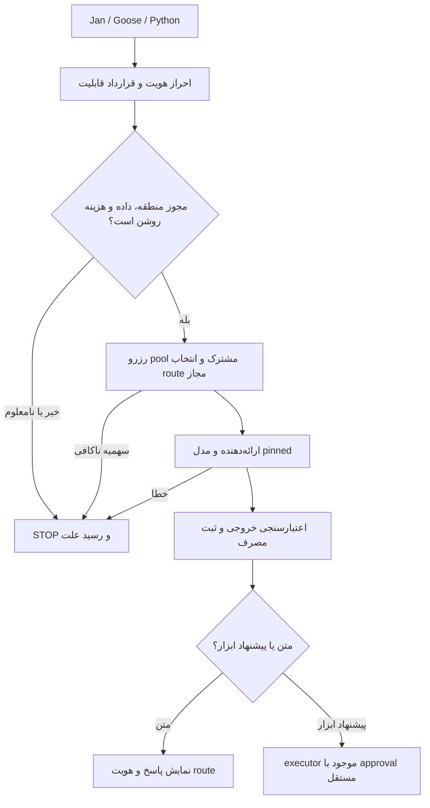

# WA0012 — کشف و ممیزی راهکارهای آمادهٔ مدیریت مشترک استنتاج ابری DJMRN

- مأموریت: WQ0012؛ تاریخ درخواست و گزارش: 2026-10-23؛ مشاهدهٔ منابع در همین اجرای Work.
- repository_full_name: `mohammadrezanabizadeh41-png/DJMRN-Intelligent-Assistant`؛ شاخهٔ مقصد: `main`.
- وضعیت پژوهش: **SUCCESS_WITH_HOLDS**؛ در قالب رسید WQ: **PARTIAL** برای تأیید عملیاتی/حقوقی و پوشش کامل همهٔ کانال‌ها. کشف و مقایسه انجام شد؛ هیچ مسیر یا محصولی برای استفادهٔ واقعی تأیید نشد.
- روش: خواندن منابع، مستندات، کد و metadata عمومی؛ **NOT_TESTED** برای تمام رفتارهای اجرایی. هیچ نصب، build، اجرای بسته/کد نامزد، inference، probe سلامت یا سهمیه، حساب، کلید، پرداخت، KYC یا تغییر Windows/Notion انجام نشد.
- این سند مکمل [WA0011](WA0011.md) و [بازبینی آن](../reviews/WQ0011.md) است؛ تصمیم D-005 باز، G3B بسته و حدود CAP-006 برقرارند.

## 1. EXECUTIVE_DELTA_VS_WA0011

**نتیجه:** راهکار آماده برای بخش بزرگی از proxy/failover وجود دارد؛ راهکار اثبات‌شدهٔ «کشف خودکار مدل رایگانِ مجاز برای کاربر ایران + سهمیهٔ واقعی مشترک + توقف قطعی بدون هزینه + کیفیت فارسی/ابزار + Windows کم‌دردسر» پیدا نشد. NO_NEW_GATEWAY/STOP همچنان بر هر نصب مقدم است. این نتیجه شکست پژوهش نیست؛ فضای انتخاب را محدود می‌کند.

| نوع تغییر | یافتهٔ این مأموریت | اثر برای DJMRN |
|---|---|---|
| NEW | دو Bifrost مستقل: Maxim با Go/Apache-2.0 و BoeLabs با TypeScript/Bun/MIT | نام و docs آن‌ها قابل ادغام نیست؛ BoeLabs به PostgreSQL و Redis نیاز دارد. |
| NEW | نامزدهای کوچک‌تر شامل freelm، free-llm-proxy-router، Arbiter، Ficelle، Hadrian، OpenProvider و چند gateway نوظهور | فهرست به سه محصول مشهور محدود نشد؛ جدول وسیع و ممیزی عمیق جدا هستند. |
| UPDATED | freelm 0.5.2 SDK و server اختیاری دارد؛ خروجی قدیمی جست‌وجو دربارهٔ SDK-only امروز کافی نیست | endpoint مشترک بدون DB خارجی ممکن است، ولی auth اختیاری، keyless و hedging باید محدود شوند. |
| CONTRADICTED | توضیح scanner کایزر تأیید ثانویهٔ پسوند رایگان را القا می‌کند، ولی شرط واقعی OR است | `:free` می‌تواند حتی بدون اثبات قیمت صفر وارد فهرست شود؛ برای hard-zero کافی نیست. |
| UPDATED | LiteLLM budget_fallbacks از v1.92.x در docs؛ مقصد بدون model_max_budget از دید آن check نامحدود است | این ویژگی سهمیهٔ رایگان upstream را کشف/تمدید نمی‌کند. کد جدید نیز دربارهٔ رزرو نکردن fallback هم‌زمان هشدار دارد. |
| NEW | Ficelle 0.3.13 واقعاً paid fallback را در config خاموش می‌کند، اما BSL-1.1 و open-core است؛ pool گستردهٔ نگهداری‌شده در Pro | «source available» با OSS آزاد و «free core» با همهٔ امکانات آماده یکی نیست. |
| NEW | SambaNova: جدول free و صفحهٔ Plans دربارهٔ پرداخت ناسازگار؛ ToS محدودیت صادرات دارد. OVH: anonymous محدود و قیمت‌های غیرصفر رسمی | تبلیغ keyless/free در روترها entitlement واقعی یا مجوز ایران نیست. |
| RECONCILED | Notion Applied هنوز اصلاح تاریخی HF را $0.10/month می‌نامد؛ صفحهٔ رسمی فعلی Free Users=None است | baseline WA0011 در این مورد با منبع فعلی سازگار است؛ نسخهٔ تاریخی Notion بی‌سروصدا جای حقیقت فعلی قرار نگرفت. |
| UNCHANGED | quota account/org مشترک است؛ HTTP 429 همیشه daily نیست؛ tool retry مجوز عمل نیست | مدل‌های بیشتر سهمیهٔ تازه ایجاد نمی‌کنند؛ cloud model هرگز executor امن را جایگزین نمی‌کند. |
| UNKNOWN | مجاز بودن حساب واقعی، موجودی، کیفیت فارسی/tool schema، RAM، startup/reboot و سخت‌گیری هزینه در اجرا | هیچ برچسب VERIFIED_RENEWABLE_FREE_FOR_USER صادر نشد؛ همهٔ مسیرهای عملیاتی فعلاً DENY/HOLD. |

سه گزینهٔ مشروط برای بررسی بعدی: Maxim Bifrost برای gateway عمومی، freelm برای SDK/server کوچک با کنترل صریح، و freellmpool برای catalog غنی ولی نیازمند محدودسازی. این‌ها برندهٔ نصب نیستند؛ مقایسهٔ وزن‌دار فقط پس از عبور gate معتبر است.

## 2. سه رسید منبع

### APPLIED_LIBRARY_READ_RECEIPT

**READ — selective semantic review، نه ممیزی کامل همهٔ صفحات workspace.** پنج صفحهٔ زنده با connector Notion واقعاً fetch شدند؛ متن برگشتی دریافت و بخش‌های حاکمیتی/مرتبط بررسی شد. بزرگ بودن متن به معنی خواندن معنایی تمام کتابخانه نیست. آخرین ویرایش‌های زیر metadata همان fetch هستند، نه زمان اجرای این گزارش.

| صفحهٔ زنده | ID و لینک | آخرین ویرایش گزارش‌شده | آنچه بررسی شد |
|---|---|---|---|
| Persistent Operating Memory | [3edc8c684690814a9707cb880534f462](https://www.notion.so/3edc8c684690814a9707cb880534f462) | 2026-10-20T16:48:30.778Z | authority، تداوم، free-first، مرز اجرا و پژوهش |
| Tool Governance & Architecture | [3edc8c68469081cc90abdd5183f1bdb1](https://www.notion.so/3edc8c68469081cc90abdd5183f1bdb1) | 2026-10-17T16:40:34.103Z | permission، ابزار در برابر مدل، عدم نصب/پلتفرم‌سازی خودکار |
| Applied Capability Index v0.48 | [3fdc8c684690817a9b5acef3c108253f](https://www.notion.so/3fdc8c684690817a9b5acef3c108253f) | 2026-10-20T17:01:05.277Z | R016، R018، R021، ثبت LiteLLM، gateway/Archestra و اصلاح HF |
| Applied mission/library | [3fdc8c6846908167a77feab9564dc66d](https://www.notion.so/3fdc8c6846908167a77feab9564dc66d) | 2026-10-20T17:08:47.939Z | مأموریت و مرز کاربردی کتابخانه؛ عدم تبدیل discovery به تصویب |
| General Living Research، Discovery054/v52 | [3fbc8c684690817d8c94cce0bfaa1a59](https://www.notion.so/3fbc8c684690817d8c94cce0bfaa1a59) | 2026-10-18T15:00:07.265Z | ارتباط R016/R018/R021، زیرساخت inference و gateway، سابقهٔ حقوق/بودجه/حریم خصوصی |

جست‌وجوی literal بدون حساسیت به بزرگی حروف در Index: LiteLLM=3، OpenRouter=4؛ General: LiteLLM=15. در هر دو متن برای Bifrost، Portkey، freelm، freellmpool، Ficelle، arbiter، Hadrian، New API، One API، SambaNova، OVH نتیجهٔ انگلیسی صفر بود. این فقط «در scope متن برگشتی با این literal» است؛ نبود alias فارسی/تمام صفحات را ثابت نمی‌کند. LiteLLM در جدول BOTH است؛ نامزد تازه‌ای که فقط در WA0011 بوده ALREADY-IN-PROJECT است. خلاصهٔ R016/R018/R021 دوباره به صورت پروژهٔ تازه ثبت نشد. Archestra از قبل در Applied/General دیده شد؛ به‌علت نقش گستردهٔ tool/agent gateway، نیازهای Docker/privilege و فقدان نیاز واقعی، نامزد نصب این مأموریت نیست.

تعارض واقعی مهم: یادداشت Applied در زمان خود HF Free=$0.10/month را اصلاح می‌دانست؛ منبع رسمی فعلی خلاف آن است (S-HF). تاریخ و درجهٔ شواهد حفظ شد؛ Notion ویرایش نشد. مرجع تصمیم جاری repo است و هیچ کتابخانهٔ فرصت، مجوز فعال‌سازی محسوب نشد.

### PROJECT_REPOSITORY_READ_RECEIPT

metadata خصوصی متصل: repository id **1427268660**، full_name دقیق، default_branch=main، archived=false، امکان push گزارش شد. ref زندهٔ آغاز: **32860f0cd6a6fa751ffcb136c0bdd7cf041c821e**. tree recursive در همان مرحله truncated=false؛ AGENTS.md یافت نشد؛ WA0012 موجود نبود و fetch مستقیم 404 بود. نبود AGENTS در همین tree است، نه فرض جهانی.

WQ0012 **کامل** خوانده شد. PROJECT-RULES، lock و Work protocol خوانده شدند. CURRENT طبق دستور فقط prefix حاکم و مدخل‌های مرتبط جدید خوانده شد؛ task/decision/KB/inventory با گزینش موضوعی تطبیق شدند. WA0011 به عنوان baseline کامل موجود و بازبینی آن کامل خوانده شد؛ در این دور جدول‌ها و موارد اختلاف دوباره استخراج شد.

| فایل در snapshot آغاز | Git blob |
|---|---|
| PROJECT-RULES.md | 078d043088103729863384e681d66eb2c05221a9 |
| 04-work-research-bridge/REPOSITORY-LOCK.md | 231778be56580deedcd1d5c0c5de54bc093552fc |
| 04-work-research-bridge/README.md | fa5fdf56ad50714e6e4479fe5111ec6f1036be27 |
| 04-work-research-bridge/requests/WQ0012.md | c17186a515ad4c596d7499b8f1a6c7074398d635 |
| 07-operations-and-continuity/CURRENT-STATUS.md | fe0a79a18533fb124415a815520d745d2080c1f9 |
| 04-work-research-bridge/responses/WA0011.md | 73e0b672393cb6ef8698c430e8a0303fd6e3ceea |
| 04-work-research-bridge/reviews/WQ0011.md | 452770139ea470156dc2e975779bb42f00c628d9 |
| 02-project-management/TASK-REGISTER.md | 0d26ab18862cfae3b161d097b2f0468fab16d467 |
| 02-project-management/DECISION-REGISTER.md | aa3f26226228aece68aff04866716005a27fa5ba |
| 08-project-knowledge-base/INDEX.md | 8ef55004955f112427c9de3246564ff2efe45804 |
| 08-project-knowledge-base/SOURCE-REGISTER.md | 8ed89a1c488289bacc1d12fc7ff3a873ec0c7fb1 |
| 07-operations-and-continuity/LOCAL-ENGINE-AND-MODEL-PATH-REGISTER.md | 0c5a4ccfa581af54aad49ae45f9b6f777be34fcd |
| 03-architecture-and-tools/FUTURE-INFERENCE-PLANE-RESEARCH-REQUIREMENT.md | 555197237262f9ec8beffd787cb5769f8295feb6 |
| 06-tests-and-evidence/logs/GOOSE-G4-GEMMA1B-PERSIAN-SELF-INTRO-QUALITY-FAIL-20261022.md | 59386fa341c52e7e590599ce92e95970885c29c7 |
| 06-tests-and-evidence/logs/KYNXA-H3-PARKED-AUTOMATION-CRITERION-20261022.md | 46fb685bd0e743ca38099c6ac700f3ac3cc99cb3 |

WA0011 ثابت: commit **0fde04fa6be632403a1a524fd6de332515866f5b**، blob بالا. review حمل/ثبت آن را تأیید کرده، اما eligibility یا کیفیت vendor را تصدیق نکرده است. دستور تاریخی WAIT در review با dispatch جدید WQ0012 و دستور صریح کاربر جایگزین شده؛ بقیهٔ holdها برقرارند.

وضعیت معتبر: TASK-0017/TASK-0023 موجود، پروژه/وظیفهٔ تازه ایجاد نشد؛ D-003 free-first، D-009 capability-first، D-014 chat-first، D-015 دو سطح گفتگو با هستهٔ ابزار مشترک، D-005 باز. D-015 به معنی دسترسی API از ChatGPT Plus یا MCP آماده نیست. G3B/anti-TOCTOU باز نشده است. evidence جدید کاربر دربارهٔ Goose بر موجودی تاریخی NOT_INSTALLED مقدم است؛ خود گزارش screenshot، runtime/version/امنیت کامل را ثابت نمی‌کند.

### INDEPENDENT_SEARCH_RECEIPT

**READ / PARTIAL CHANNEL COVERAGE.** جست‌وجوی مستقل جدید قبل از محدودکردن به نام‌های WQ انجام شد، سپس هویت دقیق با GitHub connector و کد/manifest/license/release بررسی شد. GitHub و مستندات رسمی منبع تأیید هستند؛ topic، directory، snippet و فهرست ثانویه فقط سرنخ‌اند. GitLab واقعاً بررسی شد؛ Codeberg به robots.txt مسدود بود؛ npm یک صفحه 403 داشت ولی نتایج registry دیگر و manifest اصلی خوانده شد. این محدودیت‌ها با عبارت «پوشش جامع همهٔ اینترنت» پنهان نشده‌اند. هیچ endpoint استنتاج یا models API دارای credential صدا زده نشد.

## 3. DISCOVERY_QUERY_AND_CHANNEL_LEDGER

| کانال/عبارت‌های اجراشده | نتیجه و بررسی | حد/رد |
|---|---|---|
| وب عمومی: open source quota aware free LLM router provider model discovery Windows gateway؛ OpenAI compatible proxy automatic model catalog discovery free provider failover | کایزر، Arbiter، freelm، Ficelle، Hadrian و alternatives؛ سپس منبع اصلی | ranking موتور جست‌وجو پوشش کامل نیست؛ free در نام دلیل حق استفاده نیست |
| GitHub topics llm-gateway، llm-router و جست‌وجوی gateway/proxy/OpenAI/failover | [topic مرتب‌شده با update](https://github.com/topics/llm-gateway?o=desc&s=updated)، metadata exact owner، README، trees، license، release | stars و updated_at امتیاز امنیت نیست؛ مشاهدهٔ HEAD با آخرین release یکی نیست |
| GitLab: site:gitlab.com LLM gateway quota router؛ llm gateway OpenAI | [openai-api topic](https://gitlab.com/explore/projects/topics/openai-api?language_name=Python&sort=created_desc) خوانده شد؛ forkهای LiteLLM و پروژه‌های نامرتبط دیده شد | forkهای GitLab.org/modelops و ramtinhoss1 به عنوان محصول مستقل شمرده نشدند؛ candidate تازهٔ واجد شواهد استخراج نشد |
| Codeberg: site:codeberg.org llm router؛ llm proxy | جست‌وجوی واقعی؛ non-retryable robots denial | **PARTIAL/NOT_CONTENT_READ**؛ دسترسی دور زده نشد؛ نبود پروژه ادعا نمی‌شود |
| Hugging Face: site:huggingface.co/spaces LLM router gateway | [llm-semantic-router/playground tree](https://huggingface.co/spaces/llm-semantic-router/playground/tree/main) واقعاً باز شد | demo تخصصی routing و UI؛ Running badge به معنی API رایگان قابل اتکای DJMRN یا مدل مجاز نیست؛ اجرا نشد |
| PyPI: free router LLM proxy؛ freelm 0.5.2 | [freelm 0.5.2](https://pypi.org/project/freelm/0.5.2/)، manifest منبع و نسخه تطبیق شد؛ freellmpool baseline | artifact دانلود/نصب نشد؛ اندازهٔ wheel معیار RAM نیست؛ trusted publishing برای freelm طبق صفحه No |
| npm: gateway free LLM router؛ free-ai-pool؛ freelm | [free-ai-pool](https://www.npmjs.com/package/free-ai-pool) 2.2.2 سرنخ اصلی؛ freelm JS package 0.5.2 به همان repo اشاره می‌کند | fetch صفحهٔ npm freelm=403؛ registry provenance آن مستقلاً کامل نشد؛ Python و JS freelm دو محصول مستقل شمرده نشدند |
| رسمی محصول/کد: boelabs routing؛ New API / One API؛ automatic free catalog و budgets | دو Bifrost، خاندان One/New API و code audit زیر | نمونهٔ YAML قابلیت آمادهٔ «حقوق ایران» تولید نمی‌کند |
| رسمی ارائه‌دهنده: SambaNova free rate limits/plans/terms؛ OVH AI Endpoints billing/capabilities/pricing؛ HF pricing؛ Kilo terms؛ AvalAI | تعارض‌ها و موانع material در بخش 7 | signup، dashboard و تماس با vendor مجاز نبود؛ هیچ باقیماندهٔ سهمیه‌ای ساخته نشد |

توقف کشف بعد از بیش از ۲۰ identity مستقل و ۱۰ ممیزی عمیق/مقایسه‌ای بود: نتایج جدید عمدتاً به keyless نامجاز/نامشخص، ادغام subscription، fork، پلتفرم سنگین، یا همان فقدان eligibility و hard-zero می‌رسیدند. جست‌وجوی بزرگ‌تر احتمالاً فهرست را بلندتر می‌کند؛ برای شکستن مانع فعلی، سند منطقه/حق حساب و آزمون mock هدفمند ارزش بیشتری دارد. Codeberg و provenance بعضی بسته‌ها همچنان شکاف واقعی‌اند.

## 4. MERGED_CANDIDATE_MATRIX

نشانهٔ سابقه، کشف در همین scope است: BOTH=Applied+repo؛ ALREADY-IN-PROJECT=WA0011؛ NEW-EXTERNAL=در دو متن زندهٔ Index/General با literal یافت نشد و برای این پژوهش بیرونی تازه است. ستارهٔ D یعنی ممیزی عمیق بخش5. نسخهٔ نامشخص عمداً latest حدس زده نشده است. license های «ادعا» فقط README هستند؛ متن LICENSE مستقل در ledger مشخص است.

| # / هویت دقیق و نقش | سابقه | نسخه/مجوز/تازگی مشاهده‌شده | نتیجهٔ غربال |
|---|---|---|---|
| 1 D [BerriAI/litellm](https://github.com/BerriAI/litellm)؛ SDK و Proxy دو سطح یک پروژه | BOTH | releases/latest v1.106.2، 2026-10-21؛ OSS MIT و امکانات enterprise با scope جدا، baseline | سازگار عمومی؛ DB/Redis و سیاست fallback بیش از نیاز یک client؛ سهمیهٔ upstream بومیِ اثبات‌شده ندارد |
| 2 D [maximhq/bifrost](https://github.com/maximhq/bifrost)؛ gateway Go | ALREADY-IN-PROJECT | Apache-2.0 طبق README؛ default dev؛ latest=ent-v2.3.2-base 2026-10-21، **نسخهٔ OSS نامیده نشد** | گزینهٔ مشروط عمومی؛ همان بررسی WA0011 بازاستفاده، delta هویت/release تازه |
| 3 D [boelabs/bifrost](https://github.com/boelabs/bifrost)؛ gateway Bun | NEW-EXTERNAL | MIT LICENSE خوانده شد؛ v0.3.0، 2026-10-20؛ HEAD f747c68abc0763ee0e72bca1448f7cefc0be5bdf | مستقل از Maxim؛ PostgreSQL18+ و Redis8+، pre-1.0؛ برای laptop فعلی پیچیده |
| 4 [Portkey-AI/gateway](https://github.com/Portkey-AI/gateway)؛ OSS/hosted gateway | ALREADY-IN-PROJECT | نسخه/edition baseline WA0011؛ stable1.15.2 در برابر prerelease2؛ دوباره release audit کامل نشد | feature/edition باید pin شود؛ free inference از OSS نتیجه نمی‌شود |
| 5 D [0xzr/freellmpool](https://github.com/0xzr/freellmpool)؛ free catalog/SDK/proxy | ALREADY-IN-PROJECT | MIT README، v0.13.0، 2026-08-30؛ Beta baseline | catalog غنی، نه ۲۳ سهمیهٔ قابل‌مصرف این کاربر؛ default keyless نیازمند حذف از انتخاب |
| 6 [r2hu1/freerouter](https://github.com/r2hu1/freerouter)؛ Node/Bun proxy | ALREADY-IN-PROJECT | identity و مرزها baseline WA0011؛ نسخه امروز دوباره pin نشد | policy/auth/capability gap؛ با دو freerouter بعدی یکی نیست |
| 7 [unohee/freerouter](https://github.com/unohee/freerouter)؛ Python، OpenRouter-only | ALREADY-IN-PROJECT | baseline؛ version/license جاری مجدداً ممیزی نشد | cross-provider کامل نیست؛ سقف حساب OpenRouter مشترک |
| 8 [freerouter/freerouter](https://github.com/freerouter/freerouter)؛ Laravel service | ALREADY-IN-PROJECT | Alpha در baseline؛ بازتأیید release انجام نشد | hosted app/stack؛ مناسب کمینه نیست |
| 9 D [QuantumNous/new-api](https://github.com/QuantumNous/new-api)؛ Go/web multi-model management | NEW-EXTERNAL | HEAD 7fb6e57a5ff671582131c74e00bdfaa867d4e985؛ AGPLv3 LICENSE + additional notices در README | product واقعی؛ built-in billing/quota حسابداری خودش است، نه free entitlement؛ SQLite تک‌گره ممکن |
| 10 [songquanpeng/one-api](https://github.com/songquanpeng/one-api)؛ ریشهٔ خاندان | NEW-EXTERNAL | HEAD 8df4a2670b98266bd287c698243fff327d9748cf؛ MIT LICENSE | مستقل/ancestor، نه alias New API؛ متن README شرط attribution دیگری هم بیان می‌کند، تناقض باید پیش از توزیع روشن شود |
| 11 [alienz-dev/llm-router](https://github.com/alienz-dev/llm-router)؛ Python free-tier gateway | NEW-EXTERNAL | manifest0.1.0، HEAD4b912d7036194a6f9e7f810621ab3247303409c7؛ LICENSE در tree/fetch نیافت شد | source قابل خواندن، مجوز توزیع/استفاده نامعلوم؛ امتیازهای قابلیت heuristic و quota unknown خطر دارد؛ HOLD |
| 12 D [koushikch7/arbiter](https://github.com/koushikch7/arbiter)؛ FastAPI/Redis router | NEW-EXTERNAL | MIT LICENSE؛ README v1.21.0 changelog؛ releases/latest یافت نشد؛ HEAD0fd79cab75ee1abb4ec67905e629ae42164703aa | ready features بیشتر، اما Redis/runtime/state و hardcoded catalog نیازمند ممیزی؛ انتخاب فعلی نیست |
| 13 D [kaiser-data/free-llm-proxy-router](https://github.com/kaiser-data/free-llm-proxy-router)؛ Go single binary | NEW-EXTERNAL | MIT LICENSE؛ v0.1.1 2026-10-18؛ HEAD07ef8df94ba51a0115fbb707e441e83e1d8e0c2e | Windows zip واقعی؛ bind همهٔ interfaceها در کد و free OR bug مانع پذیرش پیش‌فرض |
| 14 D [shihabshahrier/freelm](https://github.com/shihabshahrier/freelm)؛ Python/TS SDK + optional server | NEW-EXTERNAL | MIT LICENSE؛ v0.5.2 2026-10-10؛ HEADc6218f273528a743d572eb117f1da508ccf7b843 | یکی از کم‌اجزاترها؛ hedging/keyless/silent model fallback و quota durability مشروط |
| 15 D [TheBlueHouse75/ficelle-open-core](https://github.com/TheBlueHouse75/ficelle-open-core)؛ strict-zero router | NEW-EXTERNAL | BSL-1.1؛ v0.3.13، 2026-10-05؛ HEAD350b724e17d1b7d0d0d95bf41d8938e7a2f171c9 | OSS آزاد فعلی نیست؛ free core محدود، pool گسترده Pro؛ مدل رایگان مجاز ایران ثابت نیست |
| 16 D [hadriangateway/hadrian](https://github.com/hadriangateway/hadrian)؛ Rust gateway | NEW-EXTERNAL | v0.0.1-alpha.14 2026-06-12؛ MIT/Apache dual طبق README؛ HEAD40a33e0762d23828cdf1da9913fb5234bd9a3d76 | warning صریح alpha/بدون security audit/احتمال data loss؛ Windows assets وجود دارد، برای دادهٔ حساس HOLD |
| 17 [Helicone/ai-gateway](https://github.com/Helicone/ai-gateway)؛ Rust gateway/cache | NEW-EXTERNAL | Apache README؛ public beta؛ README blob در ledger | auth باید فعال شود؛ observability/cache ≠ quota/free detector؛ depth محدود |
| 18 [api7/aisix](https://github.com/api7/aisix)؛ Rust declarative gateway | NEW-EXTERNAL | Apache2 README؛ HEAD449a7d6a476bf970b8da487356c2266b04fd2233 | OSS بدون DB ممکن؛ console/team budgets بخشی Enterprise/Cloud؛ نیاز low-memory/runtime نامعلوم |
| 19 [OpenProviderAi/OpenProvider](https://github.com/OpenProviderAi/OpenProvider)؛ Next.js/Postgres gateway | NEW-EXTERNAL | MIT badge؛ current README source؛ alias قدیمی vkop007 در deploy link، محصول جدا شمرده نشد | free + free-allocation + trial مخلوط؛ DB/OAuth/hosting اضافه؛ zero claim به حق حساب تعمیم ندارد |
| 20 [Mohammedesabbar/omniroute](https://github.com/Mohammedesabbar/omniroute)؛ Node dashboard/router | NEW-EXTERNAL | default release/v3.8.51؛ MIT badge؛ README جاری | headline توکن تجمیعی ناشر، entitlement نیست؛ keyless خودکار و subscription/OAuth route خطر scope؛ HOLD |
| 21 [AndrewTtofi/llm-gateway](https://github.com/AndrewTtofi/llm-gateway)؛ gateway/Redis/Postgres | NEW-EXTERNAL | current README blob؛ license مستقل این دور UNKNOWN | admission Lua ادعای خوب، **Redis down fail-open** در README؛ با DJMRN ناسازگار پیش‌فرض؛ stack سنگین |
| 22 [nativegatewayhq/gateway](https://github.com/nativegatewayhq/gateway)؛ native multimodal gateway | NEW-EXTERNAL | current README؛ early Phase2؛ license مستقل UNKNOWN | عمدتاً media/Gemini و Postgres17؛ rate limit/health default disabled؛ chat نیازمند depth بیشتر، فعلاً خارج shortlist |
| 23 [free-ai-pool npm](https://www.npmjs.com/package/free-ai-pool)؛ Node18/SQLite/PM2 | NEW-EXTERNAL | npm2.2.2؛ source owner و license مستقل این دور UNKNOWN | URL admin token در query/log نمونه؛ bootstrap/background/reboot ادعای ناشر؛ هویت ناکامل، نه نامزد عمیق |
| 24 [OpenRouter](https://openrouter.ai/docs/guides/routing/routers/free-models-router)؛ hosted aggregator | BOTH | سرویس، نه OSS gateway محلی؛ baseline WA0011 | free router از routes واجد feature انتخاب می‌کند؛ entitlement/ToS/سقف حساب لازم |
| 25 [Cloudflare AI Gateway](https://developers.cloudflare.com/ai-gateway/)؛ hosted gateway | ALREADY-IN-PROJECT | سرویس مجزا از Workers AI inference؛ baseline | hosting gateway quota مدل نمی‌دهد؛ privacy/account gates باز |
| 26 [HF semantic-router playground](https://huggingface.co/spaces/llm-semantic-router/playground/tree/main)؛ demo/selector | NEW-EXTERNAL | tree مشاهده؛ artifact مجوز و backend depth محدود | Space رایگان معادل سرویس inference رایگان عمومی نیست؛ برای workload کمینه نامتناسب |

**Dedup/exclusion:** Python/JS freelm یکی؛ New API و One API دو codebase با ancestry مشترک؛ دو Bifrost بدون ancestry ادعاشده، دو محصول مستقل. oomplay/free-llm-proxy-router-standalone، Pr0fess0rOP/free-llm-router و نام‌های مشابه FreeLLMAPI با منشأ/مجوز نامشخص، به تعداد core candidates اضافه نشدند. فهرست‌های rebrand و mirrorهای غیررسمی منبع تأیید نبودند. ClawRouter/x402 و subscription-to-API converters به علت مسیر پرداخت یا حق استفادهٔ نامعلوم از shortlist خارج شدند؛ هیچ entitlement از اشتراک chat استنتاج نشد. Archestra قبلاً در کتابخانه وجود دارد؛ platform/tool execution اضافی برای این سؤال کمینه نیست.

## 5. FEATURE_REALITY_MATRIX

### درجهٔ شواهد و خواندن جدول

FACT=متن واقعی کد/metadata/license دیده شده؛ BUILT_IN_VERIFIED_SOURCE تنها وجود قابلیت در منبع را می‌گوید، **نه صحت اجرایی یا امنیت تأییدشده**. PUBLISHER CLAIM=README/bench ناشر بدون بازبینی مسیر کد؛ USER-OBSERVED=شاهد کاربر repo؛ INFERENCE=تحلیل این گزارش؛ UNVERIFIED=مدرک کافی نیست. تمام تست‌های runtime **NOT_TESTED**.

کدهای سلول دقیقاً به این برچسب‌ها نگاشت می‌شوند: **B = BUILT_IN_VERIFIED_SOURCE**، **C = CONFIG_ONLY**، **P = PLUGIN_OR_PAID_EDITION**، **X = REQUIRES_CUSTOM_CODE**، **A = CLAIM_ONLY**، **M = MISSING**، **U = UNKNOWN**. X به معنی «مجوز ساخت adapter» نیست؛ برعکس، شکاف آماده بودن را نشان می‌دهد. C نیازمند پیکربندی و آزمون آینده است. U به دلیل فقدان شواهد مناسب انتخاب شده، نه اثبات نبود قابلیت. هر سطر یک قابلیت است و هر ستون یک نامزد عمیق؛ حدود و منبع هر نامزد پس از جدول آمده است.

| قابلیت | LiteLLM Proxy | Maxim Bifrost | BoeLabs Bifrost | freellmpool | freelm |
|---|---|---|---|---|---|
| Chat Completions HTTP مشترک | B | B | B | B | B |
| Responses API با semantics کامل | B | B | B | U | U |
| Streaming و پایان امن پس از قطع | C | C | B | U | U |
| انتقال tools/JSON schema بدون downgrade | C | C | C | C | C |
| Alias و pool/fallback قابل تنظیم | B | B | B | B | B |
| کشف catalog از endpoint رسمی | C | C | M | C | C |
| طبقه‌بندی رایگانِ تجدیدپذیر برای همین کاربر | X | X | X | X | X |
| telemetry سهمیهٔ واقعی حساب/زمان reset | U | U | U | U | U |
| رزرو اتمیک سهمیهٔ مشترک دو client | U | U | U | U | U |
| بقای budget/quota معتبر پس از reboot | C | C | U | U | U |
| هویت client و بودجهٔ جدا | B | B | B | U | U |
| loopback + auth اجباری در حالت مطلوب | C | C | C | C | C |
| hard-zero همهٔ مسیرها و هزینه‌های پنهان | X | X | X | X | X |
| error policy محدود 429/401/403/402 | C | C | C | U | C |
| startup/recovery بومی Windows آماده | U | U | U | U | U |
| عدم اجرای/retry ابزار بیرونی در مسیر مطلوب | C | C | C | C | C |

| قابلیت | کایزر | Arbiter | Ficelle Core | New API | Hadrian |
|---|---|---|---|---|---|
| Chat Completions HTTP مشترک | B | B | B | B | B |
| Responses API با semantics کامل | U | U | U | B | U |
| Streaming و پایان امن پس از قطع | U | A | U | C | A |
| انتقال tools/JSON schema بدون downgrade | C | A | U | C | A |
| Alias و pool/fallback قابل تنظیم | B | B | B | B | A |
| کشف catalog از endpoint رسمی | B | A | B | C | U |
| طبقه‌بندی رایگانِ تجدیدپذیر برای همین کاربر | X | X | X | X | X |
| telemetry سهمیهٔ واقعی حساب/زمان reset | U | U | U | U | U |
| رزرو اتمیک سهمیهٔ مشترک دو client | U | U | U | U | A |
| بقای budget/quota معتبر پس از reboot | U | C | C | C | A |
| هویت client و بودجهٔ جدا | U | C | U | B | A |
| loopback + auth اجباری در حالت مطلوب | X | C | C | C | C |
| hard-zero همهٔ مسیرها و هزینه‌های پنهان | X | X | C | X | U |
| error policy محدود 429/401/403/402 | U | A | C | C | A |
| startup/recovery بومی Windows آماده | U | U | U | U | U |
| عدم اجرای/retry ابزار بیرونی در مسیر مطلوب | C | C | C | C | C |

**محدودیت عمومی دو جدول:** هیچ محصولی اثبات منطقه/حق حساب و کیفیت فارسی را به صورت بومی ارائه نکرده است. در ردیف reboot، باقی ماندن SQLite/JSON فقط بقای دادهٔ محلی است؛ remaining upstream معتبر بعد از crash نیست. در ردیف آخر C یعنی فقط قابلیت inference استفاده شود و MCP، server tools، browser/search، code execution و agent loop فعال نشوند؛ اجرای ابزار فقط executor موجود با approval مستقل است.

### 5.1 دو Bifrost مستقل

| محور | maximhq/bifrost | boelabs/bifrost |
|---|---|---|
| نگه‌دارنده/هویت | Maxim؛ default dev، repo id951115072 | BoeLabs؛ main، repo id1367775803 |
| زبان/مجوز | Go؛ Apache-2.0 در README و baseline | TypeScript/Bun؛ MIT LICENSE مستقل دیده شد |
| نسخه | releases/latest enterprise-base؛ نسخهٔ مناسب OSS باید جدا pin شود | v0.3.0 release واقعی؛ HEAD و docs ممکن است جلوتر باشند |
| نیازمندی | HTTP gateway و SQLite در baseline؛ governance edition جدا بررسی شود | Bun1.4+، PostgreSQL18+، Redis8+؛ dashboard Next.js اختیاری |
| Windows | baseline wrapper/Go path؛ امضای binary و راه‌اندازی واقعی NOT_TESTED | Windows/Bun به تنهایی وابستگی Postgres/Redis را حذف نمی‌کند؛ مسیر کم‌دردسر native اثبات نشد |
| catalog | فهرست/provider integration با config؛ free entitlement خودکار ثابت نیست | JSON هر adapter در startup؛ custom catalogEntry در DB؛ live renewable-free discovery نیست |
| pool/error | fallback/governance در baseline؛ policy صحیح نیازمند config | weighted pool، failureDomain مشترک، Redis circuit اتمیک، طبقه‌بندی خطا و deadline در docs |
| مخاطره | enterprise feature/release را با OSS قاطی نکن | price strategy در unknown/mixed price به weighted برمی‌گردد؛ برای DJMRN باید قبل از آن DENY شود |
| نتیجه | گزینهٔ مشروط عمومی | مستندات routing قابل‌توجه، اما stack/بلوغ نامتناسب با کمینه فعلی |

BoeLabs: README، routing، fallbacks، model-catalog و LICENSE واقعاً خوانده شد. catalog اعلام capabilities و strictTools دارد، اما صحت metadata در upstream آزموده نشده است. fallback validation اشتراک یک operation را می‌سنجد؛ این به معنی هم‌ارزی کیفیت فارسی، privacy یا همهٔ schemaها نیست. `failureDomain` برای quota identity مشترک مفید است؛ از چند deployment سهمیهٔ مصنوعی نمی‌سازد. TPM ثبت موفقیت با reservation بدبینانهٔ پیش از هر درخواست یکسان نیست. docs پس از اولین frame قابل‌مشاهدهٔ stream، replay شفاف را متوقف می‌کند؛ این رفتار source-documented است، runtime تأیید نشده. سقف انتظار Retry-After داخلی ممکن است کمتر از reset روزانه باشد؛ scheduler upstream باید مستقل معتبر بماند.

### 5.2 LiteLLM SDK در برابر Proxy و budget_fallbacks

SDK به‌تنهایی endpoint مشترک/virtual-key service نیست. Proxy برای چند client قابلیت بیشتری دارد، اما DB و برای enforcement چند worker معمولاً Redis/حالت counter مشترک مطرح می‌شود؛ SDK سبک‌تر همان محصول حسابداری چندکاربره نیست. baseline WA0011 به‌جای تکرار کل provider integrations بازاستفاده شد.

**مدرک دقیق delta:** docs اصلی BerriAI/litellm-docs، `docs/proxy/budget_fallbacks.md`، blob241dfc86ef32bee0171b44c73f9f68d3cf257818: از v1.92.x؛ trigger عبور spend یک virtual key از model_max_budget است. مقصد فاقد entry در همین check نامحدود تلقی می‌شود. این «نامحدود» مجوز provider یا حذف budgetهای دیگر نیست؛ صرفاً نبود cap در این لایه است. router-level fallback خطای upstream مسیر جدا دارد.

کد جاری `litellm/proxy/auth/fallback_budget.py` blob a126a53821b584d711b6ae3894434f968fc174e9، محدودیت رزرو نکردن counter در fallbackهای هم‌زمان و metadata ناقص بعضی endpointها را مستند می‌کند؛ `enforce_fallback_budget` به‌تنهایی تضمین سقف سخت نیست. این کد از default source جاری خوانده شد؛ **اثبات وجود همان رفتار در تمام v1.106.2/نسخه‌های enterprise نیست**. release و source HEAD با هم یکسان فرض نشده‌اند. auth_checks نیز blob8887d86570a5a77a6d7736066e280d39ebc348cc خوانده/جست‌وجو شد. این مشاهده محدود است، نه گزارش vulnerability تأییدشده در نسخهٔ مستقر. حداقل سیاست بعدی: هیچ fallback بدون cap/allowlist، هیچ wildcard یا alias پولی، unknown pricing=DENY، quota مشترک upstream مستقل از dollar spend؛ اگر adapter تازه لازم شود، ابتدا ارزش آن در برابر baseline سنجیده شود.

### 5.3 freellmpool — بازاستفادهٔ پژوهش با delta محدود

v0.13.0 و README تازه دوباره دیده شد. ناشر 23 گروه، 178 route فعال و443 مدل catalog را اعلام می‌کند؛ این اعداد سه چیز متفاوت‌اند و **هیچ‌یک تعداد مدل مجاز این کاربر نیست**. recurring، keyless، trial، pin-only و disabled جدا می‌شوند؛ همین تفکیک مزیت واقعی catalog است. پیاده‌سازی counterهای محلی UTC و error/fallback در WA0011 بررسی شده بود؛ این دور همان audit دوباره اجرا نشد. Python>=3.11، httpx و proxy اختیاری در baseline؛ نصب/راستی‌آزمایی wheel این دور انجام نشد. محدودسازی به provider/model pinned واجد شرایط، حذف keyless/trial/paid/unknown و اثبات auth/stream/counter restart هنوز شرط است. MCP یا tool provider اضافه فعال نشود؛ endpoint inference تنها کافی است. npm integrationهایی که README «publication pending» می‌گوید منتشرشده فرض نشدند.

### 5.4 freelm — کم‌اجزا ولی سیاست آمادهٔ DJMRN نیست

MIT، Python>=3.9 با httpx، JS Node>=20 بدون dependency runtime در manifest؛ هر دو نسخه0.5.2 به یک repo اشاره می‌کنند. PyPI0.5.2 واقعی و GitHub release/دو manifest تطبیق شد؛ صفحهٔ npm freelm403 بود و registry authenticity کامل تأیید نشد. CLI `serve` endpoint مشترک دارد. `server.py` loopback پیش‌فرض و Host check دارد؛ auth loopback اختیاری است، پس DJMRN باید token واقعی و deny بدون token را در پیکربندی مطلوب الزام کند. غیرloopback بدون کلید در منبع محدود شده، اما firewall/ACL/localhost threat model هنوز لازم است.

`_engine.py` hedging موازی را واقعاً دارد؛ delay تطبیقی برای chat/stream جداست. از دست دادن race درخواست upstream را «بی‌هزینه» نمی‌کند. برای سهمیه کم hedging=False، انتخاب pinned و fallback_model=False یا تنظیم معادل مستند لازم است؛ صحت این تنظیم‌ها آینده آزموده می‌شود. doctor/probe درخواست واقعی می‌فرستد؛ اجرا نشد. keyless fallback Kilo/OVH و silent تغییر مدل پیش‌فرض باید حذف شود. بیش از یک client با یک provider key، atomic shared daily reservation و crash reconciliation در این مرور تأیید نشد؛ U باقی است. این SDK به‌جای توسعهٔ gateway جدید قابل بررسی است، ولی ترکیب کردن adapter حقوق/بودجه/ledger/Windows supervisor اگر بزرگ شود عملاً نرم‌افزار تازه است و رد می‌شود.

### 5.5 free-llm-proxy-router کایزر — یافتهٔ منفی کد

MIT LICENSE، Go single-binary و Windows amd64/arm64 zip در v0.1.1 واقعاً وجود دارد؛ دانلود/امضا/اجرای آن تأیید نشده. catalog و refresh/gitsync/watch فایل واقعی دارند؛ قابلیت بروزرسانی با approval خودکار مدل یکی نیست.

در `pkg/scan/openrouter.go` شرط واقعی «قیمت ورودی و خروجی هر دو رشتهٔ صفر **یا** پسوند :free» است؛ حتی قیمت خالی یا ناسازگار با پسوند می‌تواند IsFree=true شود. comment «secondary confirmation» با پیاده‌سازی هم‌ارز نیست. قیمت cache/reasoning/tool fee و حق منطقه نیز در این شرط پوشش داده نمی‌شود؛ pagination header خوانده می‌شود ولی رسیدگی کامل به pagination TODO است. مدل‌فهرست تازه لزوماً catalog کامل نیست.

در `pkg/proxy/server.go` آدرس listener فقط `:port` است؛ `ProxyConfig` دیده‌شده Host ندارد، هرچند authMiddleware/AuthToken وجود دارد. پس «bind127.0.0.1 فقط با config همین نسخه» ثابت نیست و X ثبت شد؛ نباید با اتکا به نام localhost در README امن اعلام شود. endpoint Responses در mux دیده‌شده وجود ندارد؛ این گزارش برای آن U محافظه‌کارانه می‌گذارد چون تمام repo برای آن ممیزی نشد. برای پروژه کمینه، رفع هم‌زمان bind،free classifier،reservation و legal policy به ارزش آماده بودن لطمه می‌زند؛ خارج top3.

### 5.6 Arbiter — قابلیت زیاد، operational surface زیاد

MIT، FastAPI/Redis، README changelog تا v1.21.0 دیده شد؛ release tag مستقلی از releases/latest به دست نیامد. circuit per provider/model، daily exhaustion Cloudflare، monthly Cohere، ابزار-aware route و fail-closed Redis در README هستند: **PUBLISHER CLAIM**، نه تست امنیتی ما. `app/state_store.py` بقای تنظیمات/مدل/users در JSON با file lock را واقعاً نشان می‌دهد؛ این با بقای quota در Redis یک داده نیست. «audit پاک» و اعداد latency در changelog گواه ممیزی مستقل نیستند.

catalog کاتالوگ ناشر است؛ تبدیل Neurons Cloudflare به تعداد ثابت تماس و اعداد قدیمی Cerebras/Gemini با WA0011/official امروز قابل جایگزینی نیست. key rotation چند حساب، cron health check، email/AI analysis و remote backup سطوح اضافه‌اند؛ برای DJMRN مجوز ندارند و باید خاموش/خارج شوند. auth gateway در README optional است. حجم این سطح عملیاتی و Redis در Windows فعلی آن را پایین‌تر از SDK/proxy کوچک می‌گذارد.

### 5.7 Ficelle — strict-zero واقعی در config، محدودیت محصول واقعی

LICENSE BSL1.1 با Additional Use Grant محدود، Change Date2030-07-27 و Change License Apache2 خوانده شد. اکنون OSS مطابق مجوز آزاد معمول نیست؛ بررسی حقوقی scope استفادهٔ شخصی/ارائه خدمت هنوز لازم است. `config_store.py` واقعاً allow_paid_fallback=False را بازنویسی می‌کند؛ این بیشتر از شعار صرف است، اما تعرفه/توکن‌های پنهان upstream و region را اثبات نمی‌کند. catalog_refresh/provider_admission فایل‌های منبع موجودند؛ تمام مسیرهای admit/probe/quarantine امنیتی audit نشده‌اند.

سایت فعلی Core را با OpenRouter/Nous reference pool و pool وسیع نگهداری‌شده/virtual models پیشرفته را Pro می‌گذارد. بنابراین headline13provider به معنی13provider آمادهٔ رایگان Core نیست. پیکربندی auth loopback باید صریح باشد؛ به نمونهٔ کلید placeholder اعتماد نشود. مدل beta که موقتاً قیمت صفر دارد renewable grant تضمین‌شده نیست. probeهای recovery و demoهای simulated/benchmark ناشر اجرای واقعی ما محسوب نشدند. این محصول برای طراحی strict-zero منبع مقایسهٔ مفید است، اما به‌علت license/edition/legal gate منتخب نیست.

### 5.8 New API و One API — مدیریت آماده، سهمیهٔ upstream نامشخص

New API successor مشتق از One API است؛ exactowner QuantumNous در metadata و source تأیید شد. تغییر owner قدیمی Calcium-Ion در badge به معنی repo مقصد جدید نیست. Go+web، channel/model mapping، کاربران/گروه/کلید، logging و accounting آماده‌اند. README فعلی راه‌اندازی تک instance با SQLite را توصیف می‌کند؛ Compose پیش‌فرض Postgres+Redis دارد، پس mandatory بودن همهٔ DBها در همهٔ حالت‌ها غلط است. Redis برای limits مشترک چند node مهم می‌شود. چهار protocol در RelayKit ادعا/مستند شده‌اند؛ تبدیل fieldهای tools/schema بدون افت تضمین نشده است. قالب protocol برابر semantics نیست.

AGPLv3 و noticeهای اضافی attribution در README دیده شد؛ این مجوز هزینهٔ inference را صفر نمی‌کند. تعریف quota داخلی، user subscription و قیمت channel با remaining/renewal واقعی حساب upstream یکی نیست. risk شامل console/admin، مخزن کلید، DBbackup، session/crypto secrets و migration است. plugin/task modules اجازهٔ اجرا نیستند. One API با MIT LICENSE جداست؛ README آن از attribution اجباری هم سخن می‌گوید و ترجمهٔ ماشینی را اعلام می‌کند، پس مبنای حقوقی توزیع آینده باید با متن اصلی روشن شود. هیچ root/default credential نمونه یا secret واقعی استفاده نشد.

### 5.9 Hadrian — وجود Windows artifact، هشدار بلوغ مقدم است

README هم bullet production-ready دارد هم هشدار صریح experimental/alpha، نبود security audit و احتمال data loss ناشی از تغییر schema. هشدار محدودکننده مقدم است. Rust و SQLite/default یا stateless/DBهای اختیاری در docs؛ release v0.0.1-alpha.14 واقعاً asset ویندوز x86_64-pc-windows-msvc دارد. claims atomic budget،multi-tenant،secrets manager و protocolها تا ممیزی مسیر دقیق code **CLAIM_ONLY** هستند. هیچ بارگذاری/اجرای local یا benchmark انجام نشد. برای داده حساس یا endpoint در شبکهٔ نامطمئن کنار گذاشته می‌شود. ابزار/RAG/browser/code features نباید از کنار gateway فعال شوند.

### 5.10 شکاف‌های مشترک امنیت و supply chain

برای همه: release pin + checksum صرفاً تطبیق artifact است، امنیت یا امضای معتبر ناشر را تضمین نمی‌کند. dependency inventory/SBOM/CVE جامع این مأموریت انجام نشد؛ «CVE clean» ناشر جای آن نیست. install script/npx/uvx/auto-update، telemetry، remote catalog، plaintext env/keyfile، dashboard query token، retained request bodies و external caches باید پیش از نصب آینده جدا بررسی شوند. نسخهٔ source با نسخهٔ release در این گزارش صریح تفکیک شده است. هیچ کد از README اجرا نشد. نگه‌داشتن متن prompt در log برای debugging پیش‌فرض قابل‌قبول DJMRN نیست؛ local metadata محدود و redacted ترجیح دارد؛ upstream retention از config محلی نتیجه نمی‌شود.

## 6. FREE_MODEL_AUTO_DISCOVERY_AUDIT

«خودکار» باید به چهار مرحله شکسته شود: کشف ID، اعتبارسنجی metadata/قیمت، اثبات حق حساب و renewability، سپس admit به allowlist. بیشتر نامزدها حداکثر دو مرحلهٔ اول را دارند. listing سالم/قیمت صفر/پاسخ health موفق، مرحله سوم را ثابت نمی‌کند. هیچ GET مدل/health دارای credential یا inference در این مأموریت انجام نشد.

| نامزد/مکانیسم واقعی | آنچه می‌داند | آنچه نمی‌داند یا خطر دارد | نتیجهٔ admit |
|---|---|---|---|
| BoeLabs؛ JSON per-adapter در startup و custom catalogEntry در Postgres | operation/capability/pricing اعلام‌شده، validation ساختاری | catalog snapshot؛ نه کشف زندهٔ سهمیه/حقوق/renewal؛ reasoning effort ممکن است clamp شود | مدل جدید فقط پیشنهاد؛ no auto-enable |
| Maxim/LiteLLM؛ model/config/provider integration و pricing metadata | alias، endpoint و metadata تنظیم‌شده | dollar budget و counter محلی ماندهٔ واقعی provider نیست؛ defaultهای config می‌توانند پولی باشند | allowlist pinned؛ unknown=deny |
| freellmpool؛ registry گروه‌بندی‌شده و route فعال/disabled/trial/keyless | تمایزهای catalog مفید؛ baseline source audit | دسترسی/روز انقضای حساب و کیفیت از شمارش catalog حاصل نمی‌شود؛ UTC محلی عمومی برای همه providerها معتبر نیست | فقط subset تأییدشده؛ keyless/trial پیش‌فرض کنار |
| freelm؛ provider adapters و discovery/selection | مسیرهای provider، fallback و cache وضعیت در منبع | auth-free به معنی قانونی نیست؛ probe و hedging می‌توانند quota مصرف کنند؛ quota باقی‌ماندهٔ account اثبات نشد | pinned و fallback خاموش تا review |
| کایزر؛ scanner رسمی /models، watch و git-sync catalog | ID/context و pricing prompt/completion از OpenRouter | OR با suffix، pagination ناتمام، pricing متغیر و side fees؛ git auto-push/refresh extra action است | read-only diff پیشنهاد؛ auto-admit ممنوع |
| Arbiter؛ catalog/template + discovered flags و JSON state | enabled/free/null، تنظیمات و state پایدار | field free سه‌حالته خوب است ولی کاتالوگ ناشر/عدد call بجای Neurons truth نیست؛ periodic probe مصرف‌دار | unknown/null=deny؛ cron/probe خاموش |
| Ficelle؛ catalog refresh/admission و config strict-zero | امکان منع paid fallback؛ ادعای quarantine در تغییر قیمت | Core/Pro فرق دارد؛ beta/free امروز تجدیدپذیر نیست؛ هویت/حق upstream جدا | no auto-enable؛ license/edition gate |
| New API/One API؛ channel/model management | catalog/channel mapping و حسابداری داخلی | «quota user» داخلی، موجودی upstream را اعلام نمی‌کند؛ channel reseller می‌تواند billable باشد | fixed approved channels فقط |
| alienz؛ discovery.py و quota.py بازبینی‌شده | provider catalog واقعی به‌علاوه curated fallback، SQLite local counters | score نام مدل heuristic؛ fallback فهرست‌های قدیمی؛ در get_all_quota_status نبود cap به remaining=1.0 و healthy=true می‌رسد هرچند limits_known=false | unknown نباید headroom100% شود؛ license/logic HOLD |
| OmniRoute/OpenProvider | pool/catalog/dashboard طبق README | جمع سهمیه‌های جهانی و trial/unknown با حق واقعی یک کاربر یکی نیست؛ prewired keyless | CLAIM_ONLY؛ disabled برای DJMRN |

**استاندارد پیشنهادی برای پژوهش بعدی، نه پیاده‌سازی:** رکورد route باید provider/account-pool/model-ID/version، evidence URL/date، region status، quota scope/unit، reset provenance، price همهٔ اجزا، privacy، capabilities، expiry و approval را داشته باشد. تغییر catalog ابتدا QUARANTINED؛ حذف/غیرصفرشدن قیمت بلافاصله DENY؛ موفقیت probe آن را خودکار approved نکند. نگهداری این رکورد اگر نیازمند crawler، DB، scheduler، signature service و policy engine جدید شود، از «adapter حداقلی» عبور کرده و NO_GATEWAY بهتر است.

renewal معتبر: فقط rollover سهمیهٔ مستند همان حساب و از زمان reset واقعی؛ نه ساخت چند حساب/کلید یا تعویض مدل در همان pool. هیچ موجودی امروز، remaining دقیق یا موفقیت quota reset برای کاربر گزارش نشده است.

## 7. PROVIDER_AND_REGION_DELTA

این بخش جایگزین کل جدول WA0011 نیست. public facts تازهٔ material و تعارض‌ها بررسی شدند؛ سایر موارد صریحاً inherited هستند. **VERIFIED_RENEWABLE_FREE_FOR_USER = هیچ‌کدام**. تعیین مجوز بر پایهٔ اسناد، محدود است؛ حکم حقوقی عمومی صادر نشده. نبود سند کافی برای ایران در این پروژه UNKNOWN/DENY است، نه اجازهٔ VPN یا proxy.

### 7.1 منابع تازه و شکاف‌های مهم

| provider / منابع رسمی | عرضهٔ عمومی و scope | ایران/هزینه/داده/حساب | برچسب و نتیجه |
|---|---|---|---|
| SambaNova Cloud؛ [rate limits](https://docs.sambanova.ai/docs/en/models/rate-limits)، [plans](https://cloud.sambanova.ai/plans)، [ToS](https://sambanova.ai/cloud-end-user-license-agreement)، [pricing](https://cloud.sambanova.ai/plans/pricing) | docs free بدون payment method می‌گوید؛ برای DeepSeek-V3.1، Meta-Llama-3.3-70B-Instruct، gpt-oss-120b جدول20RPM/20RPD/200000TPD نشان می‌دهد. reset از headers روز/دقیقه؛ scope تجمیع بین مدل‌ها روشن نیست | Plans برای اولین request خرید credit/payment می‌خواهد؛ تضاد حل نشد. ToS11.10 محدودیت صادرات؛3.4 کارت on-file را خودکار شارژ می‌کند؛ benchmark publication هم شرط دارد. ایران مجاز اثبات نشد | UNKNOWN_OR_NO_LAWFUL_ACCESS؛ ارقام public entitlement نیستند، DENY. trial تاریخی $5/سه‌ماه دوباره grant جاری فرض نشد |
| OVHcloud AI Endpoints؛ [capabilities](https://docs.ovhcloud.com/en/guides/public-cloud/ai-machine-learning/ai-endpoints-capabilities)، [getting started](https://docs.ovhcloud.com/de/guides/public-cloud/ai-machine-learning/ai-endpoints-getting-started)، [prices](https://www.ovhcloud.com/en/public-cloud/prices/)، [lifecycle](https://docs.ovhcloud.com/de/guides/public-cloud/ai-machine-learning/ai-endpoints-billing) | anonymous2RPM/IP/model، authenticated400RPM/PublicCloudProject/model؛ daily renewable free grant اعلام نشد. gpt-oss-20b صفحهٔ Chat/Responses دارد؛ catalogue lifecycle حذف مدل را اعلام می‌کند | سند privacy ناشر پردازش فرانسه/عدم ذخیره یا اشتراک داده را بیان می‌کند؛ نسخهٔ قرارداد خاص Appendix10 در ابزار باز نشد. قیمت gpt-oss-20b ورودی$0.05/خروجی$0.18 و120b$0.09/$0.47 در1M token؛ no usage cap در capabilities یعنی تضمین hard spending cap نداریم. anonymous بودن entitlement تجاری یا Iran را ثابت نمی‌کند | authenticated PAID_ONLY روی مدل‌های مذکور؛ anonymous FREE_WITH_CONDITIONS/eligibility UNKNOWN؛ کل route عملیاتی DENY |
| Hugging Face Inference Providers؛ [pricing جاری](https://huggingface.co/docs/inference-providers/pricing) | Free Users=None؛ PRO/Team اعتبار ماهانه وابسته به اشتراک؛ BYOK از حساب provider خرج می‌کند | Notion historical $0.10/month با صفحه امروز ناسازگار؛ بدون grant واقعی free renew ادعا نشد. region/upstream/account و model permissions باز | PAID_ONLY برای Free user بدون grant؛ همان نتیجه WA0011 با recheck تازه |
| Kilo Gateway؛ [terms](https://kilo.ai/terms)، [provider policy catalog](https://kilo.ai/providers) | برخی روترها keyless/free آن را اضافه می‌کنند؛ ID/grant/reset معتبر برای کاربر تأیید نشد | ToS فعلی بخش صادرات ایران را صریحاً در کشورهای ممنوع ذکر می‌کند؛ استفاده از gateway سوم آن را رفع نمی‌کند. chain retention باید per-provider باشد | UNKNOWN_OR_NO_LAWFUL_ACCESS، DENY؛ keyless default freelm/دیگران مجوز دورزدن نیست |
| Nous reference در Ficelle و Routeway/Pollinations در روترهای دیگر | وجود adapter یا free label فقط سرنخ؛ مستند grant/account/model/renewal کامل خوانده نشد | region/ToS/privacy و هزینه باقی UNKNOWN؛ مدل‌های publisher sample به allowlist تبدیل نشدند | UNKNOWN_OR_NO_LAWFUL_ACCESS؛ تا evidence تازه DENY؛ این ردیف‌ها provider تأییدشده نیستند |

کیفیت فارسی، coding و tool/schema تمام IDهای بالا **NOT_TESTED** است؛ operation docs دلیل کیفیت نیست. commercial usage فقط در حدود terms/license همان سرویس قابل تصور است؛ preview SambaNova را production-ready نمی‌نامیم. معلوم نبودن KYC/card برای برخی مسیرها UNKNOWN است، نه «بدون کارت». برای OVH anonymous هیچ identity/IP rotation پیشنهاد نشد. full contract fetch ناموفق با متن دیگری جایگزین ساختگی نشد.

### 7.2 منابع ایرانی — بازخوانی محدود واقعی و بدون فعال‌سازی

| provider | delta/منبع فعلی | renewability، حقوق و hard-zero |
|---|---|---|
| [AvalAI rate limits](https://docs.avalai.ir/fa/rate-limits) | مجدداً خوانده شد: email25هزار تومان؛ phone مجموع200هزار، نه225هزار؛ limits per-model در organization. صفحات قدیمی‌تر سایت10هزار را نشان می‌دهند؛ docs جاری مقدم است | TRIAL_OR_ONE_TIME_CREDIT؛ افزایش rate tier تجدید هدیه نیست. no monthly spend cap در سند؛ کل remaining و API IDs واجد tier کاربر UNKNOWN. serving ایران با حق قراردادی upstream برابر نیست؛ privacy chain و zero-liability باز |
| [1xAi gift](https://1xai.ir/free) | مجدداً خوانده شد: یک چرخش100هزار تا1میلیون +30هزار any-model،14روز؛ profile نام/کدملی/mobile و ساخت key در flow ناشر | TRIAL_OR_ONE_TIME_CREDIT؛ promotional student/referral/developer offers recurring entitlement این کاربر نیست. chat allowance API نیست؛ هیچ signup/KYC/claim انجام نشد. exact tools/schema، retention، upstream rights و hard cap UNKNOWN |
| [Gisoo billing](https://gisoo.pro/docs/billing) | مجدداً خوانده شد: endpoint ویژه ایران و reservation max_tokens؛ سند امکان کمی منفی‌شدن balance و برآورد مصرف stream ناقص را تصریح می‌کند | PAID_ONLY بر شواهد فعلی؛ prepay برابر liability صفر نیست. invoice/FX/VAT/upstream rights لازم؛ no recurring free API اثبات شد |
| [Liara free-ai](https://liara.ir/products/free-ai/) | baseline WA0011: سرویس واقعی با fixed fee و token charge؛ audit کامل دوباره نشد | PAID_ONLY/UNKNOWN grant؛ نام URL free-ai دلیل free نیست؛ برای کمینهٔ بدون هزینه مناسب اثبات نشد |

این providers ایرانی اتصال/پرداخت محلی را ممکن معرفی می‌کنند؛ این گزارش «استفادهٔ upstream از ایران کاملاً مجاز» را از آن نتیجه نمی‌گیرد. ذخیره prompt، subprocessors، مجوز reseller، logging و شرایط دادهٔ شخصی برای همه نیازمند evidence دقیق است. هیچ فایل خصوصی پروژه به سرویس مدل فرستاده نشد.

### 7.3 baseline نگه‌داشته‌شده، بدون تکرار تحقیق

| سرویس | نتیجهٔ inherited از WA0011 و حد بازاعتبارسنجی |
|---|---|
| [OpenRouter](https://openrouter.ai/docs/api-reference/limits) | PUBLIC_FREE_WITH_UNVERIFIED_USER_ELIGIBILITY؛20RPM و50RPD حساب free؛1000RPD شرط خرید دارد و free-first خالص نیست. model rotation quota حساب را تکثیر نمی‌کند؛ upstream geography و ToS پابرجاست؛ رایگان router entitlement جدید نیست |
| [GroqCloud](https://console.groq.com/docs/rate-limits) | PUBLIC_FREE_WITH_UNVERIFIED_USER_ELIGIBILITY؛ limits org و headers؛ free route عمومی با مجاز/فعال بودن کاربر متفاوت؛ این دور جدول مدل‌ها دوباره تولید نشد |
| [Workers AI](https://developers.cloudflare.com/workers-ai/platform/pricing/) | PUBLIC_FREE_WITH_UNVERIFIED_USER_ELIGIBILITY؛10kNeurons/day/account در baseline، reset00UTC؛ Neurons برابر تعداد ثابت تماس نیست؛ AI Gateway محصول جداست |
| [Gemini Developer API regions](https://ai.google.dev/gemini-api/docs/available-regions) | UNKNOWN_OR_NO_LAWFUL_ACCESS برای این بررسی؛ Iran در فهرست baseline نبود؛ free-tier data use و per-project/model limits؛ proxy راه‌حل اجازه نیست |
| [Cerebras pricing](https://www.cerebras.ai/pricing) | TRIAL_OR_ONE_TIME_CREDIT در baseline جاری؛ ادعاهای قدیمی unlimited/free routerها تکرار نشد |
| [Mistral](https://docs.mistral.ai/admin/billing-usage/usage-limits) | FREE_WITH_CONDITIONS؛ cap/account/region واقعی باز؛ free experiment با production entitlement یکی نیست |
| [GitHub Models retirement](https://github.blog/changelog/2026-07-30-github-models-is-now-retired/) | بازنشستگی baseline؛ در فهرست‌های قدیمی قابل احیا فرض نشد |

این جدول منابع مطالعه‌شدهٔ WA0011 را ارجاع می‌دهد، نه این ادعا که همه امروز دوباره fetch شدند. تغییر material تازه (HF،SambaNova،OVH،Kilo و منابع ایرانی) جدا نشان داده شد.

### 7.4 هزینه و تمدید — تحلیل افزوده

برای هر attempt باید ورودی، خروجی، cached input، reasoning، tool/search fee، history و retries مستقل لحاظ شود. مدل بدون price reasoning یا fee ناشناخته DENY است؛ صفر بودن prompt/completion کافی نیست. معادلهٔ تحلیلی: هزینهٔ بالقوه = جمع تمام attemptها و هزینه‌های جانبی؛ cancel hedge یا stream گمشده الزاماً آن را صفر نمی‌کند. برای free request pool، هر attempt ممکن است یک درخواست محسوب شود حتی پاسخ نرسد. ماندهٔ نامعلوم پس از قطع/خارج از gateway مصرف‌شدن = UNKNOWN، نه refill صفر یا full.

محاسبات سناریویی WA0011 دوباره اجرا نشد؛ تغییر این دور شناسایی failure در مکانیزم هزینه است. free grant محدود با rollover ثابت، promotion/تمدید دستی با درخواست به vendor، و خرید credit سه چیز متفاوت‌اند. هیچ auto-recharge یا fallback paid—even cheap—در بودجه صفر مجاز نیست. نداشتن کارت به تنهایی عدم تعهد مالی را ثابت نمی‌کند؛ موجودی منفی گیسو مثال مستقیم است.

## 8. WINDOWS_AND_CLIENT_INTEGRATION

baseline دستگاه repo: Windows11 Pro، Ryzen5 3500U/Vega8،8GiB فیزیکی، حدود5.88GiB قابل رؤیت تاریخی و headroom محدود. این **اندازه‌گیری امروز نیست**؛ برای تمام gatewayها RAM/CPU/idle/دو-client/stream/reboot روی همین سخت‌افزار **UNKNOWN/NOT_MEASURED**. throughput،binary size و «zero overhead» ناشر اندازه‌گیری ما نیستند.

| انتخاب | فرایند/DB/runtime source-backed | Windows و maintenance | نتیجه |
|---|---|---|---|
| NO_NEW_GATEWAY | همان GUI موجود + HTTPS provider مجاز | daemon جدید ندارد؛ setting و manual stop، همه آینده و مشروط | کمینهٔ مطلوب؛ فعلاً provider gate باز |
| SDK/direct | Python موجود/قابل‌بررسی + SDK؛ server لازم نیست برای یک caller | برای چند app باید endpoint/process اضافه شود؛ SDK endpoint جادویی نیست | تا gap واقعی GUI اثبات نشود اضافه نشود |
| freelm/freellmpool | Python process؛ freelm Node variant هم دارد؛ DB خارجی لازم اعلام نشده | package/platform امکان‌پذیری، نه startup/reboot تأییدشده؛ یک runtime کافی، هر دو نصب نشوند | lightweight احتمالی؛ مصرف واقعی UNKNOWN |
| Maxim | Go HTTP+SQLite طبق baseline | native path محتمل؛ wrapper/npx prerequisite/edition و binary pin باید جدا روشن شود | یک gateway فقط در صورت نیاز واقعی |
| کایزر | Go binary، بدون DB خارجی در README | Windows release zip واقعاً listed؛ bind code فعلی مانع loopback-only | resource سبک احتمالی، پیش‌فرض امن نیست |
| BoeLabs | Bun+Postgres+Redis؛ dashboard اختیاری | حتی dashboard-off سه جزء دارد؛ Redis native Windows/WSL/Docker و نگه‌داری این نسخه‌ها اینجا تأیید نشد | برای8GiB کمینه نیست |
| LiteLLM Proxy | Python؛ virtual-key/DB و shared Redis در topology مربوط | Docker/WSL راهنمای عمومی به معنی الزام مطلق همه حالت‌ها نیست؛ عملیاتی‌سازی بدون friction ثابت نشد | feature-rich، burden بیشتر |
| Arbiter/New API | Python+Redis+JSON / Go+SQLite اختیاری یا Compose+Postgres+Redis | backup/migration/log retention/service lifecycle اضافه | بدون نیاز واقعی stack اضافه نشود |
| Hadrian/AISIX | Rust binary، optional DB/etcd/Redis per topology | Hadrian Windows assets observed؛ AISIX native Windows release در این دور UNKNOWN | Hadrian alpha hold؛ AISIX enterprise feature gap |

**Jan:** آدرس OpenAI-compatible قابل تنظیم می‌تواند به provider مستقیم یا loopback واحد اشاره کند؛ نسخهٔ نصب، Responses/tool protocol و auth forwarding همین دستگاه تأیید نشده. Jan را با KYNXA یا engine یکی نمی‌گیریم. **Goose:** source/user screenshot repo generation با Gemma1B را نشان داد ولی Persian self-intro نامنسجم بود؛ G4 tool reliability یا cloud path را ثابت نمی‌کند. support provider/custom base URL هر نسخه باید قبل از تغییر تنظیم تأیید شود؛ extension toolها به‌طور ضمنی روشن نشوند. **Python:** HTTP/SDK به‌عنوان client؛ با یک gateway، client key جدا و upstream key فقط داخل gateway؛ قرار دادن alias در model به تنهایی هویت/بودجهٔ client نیست.

برای آیندهٔ مجاز: یک بار setup، bind دقیق127.0.0.1، token اجباری، فایل secret خارج repo با ACL حداقلی، log بدون body/key، auto-update خاموش، یک endpoint و یک process در صورت کفایت. Startup Task/Service و recovery فقط **پیشنهاد وابسته به محصول** است؛ در این اجرا نه ایجاد شد و نه recipe تأییدشده به کاربر تحمیل شد. reboot باید با همان cap معتبر و بدون optimistic refill بازیابی شود. مصرف بیرون از gateway باید یا ممنوع/محدود یا reconciled باشد؛ نمی‌توان truth کامل از counter محلی ساخت.

اندازه‌گیری آینده بدون inference: پس از مجوز نصب، idle private bytes/working set همهٔ child processها، CPU،disk،ports و startup را با ابزار سیستم ثبت کنند؛ سپس دو درخواست به **mock محلی** برای concurrency/backpressure و shutdown/reboot. این سنجه‌ها اکنون وجود ندارند؛ عدد RAM تخمینی منتشر نمی‌شود. KYNXA به‌علت waiting-resource و نیاز اتوماسیون PARK است؛ نصب را حذف یا admission guard را دور نمی‌زنیم.

## 9. ROUTING_COST_SECURITY_FAILURE_MATRIX

### جریان منطقی — فقط مدل تصمیم پژوهشی

native در gatewayها: HTTP/auth/alias/fallback/بخشی counters مطابق بخش5. CONFIG: loopback،allowlist،client tokens،retry limits،logs. CUSTOM/UNKNOWN: سند حق منطقهٔ کاربر، مدل هم‌قابلیت با کیفیت معتبر، atomic upstream quota truth و reconciliation؛ این گزارش ساخت آن‌ها را پیشنهاد قطعی نمی‌کند. executor/approval/anti-TOCTOU دارایی موجود پروژه است و به gateway منتقل نمی‌شود. failover تنها پس از طبقه‌بندی خطا و در همان privacy/quality/cost contract ممکن است؛ لبهٔ خطا عمداً STOP محافظه‌کارانه نشان داده شده است.

ترتیب policy: deterministic capability موجود → task contract (فارسی/coding/tools/schema/context) → region/privacy/price/cap/approval → سهمیه و health → priority/weighted/latency بین **فقط routes eligible**. random بین مدل‌های ناسازگار مجاز نیست؛ alias باید actual model/provider را در receipt آشکار کند. permission انجام کار هرگز از مدل منتخب نمی‌آید.

| سناریوی الزامی؛ همه NOT_TESTED | رفتار مطلوب/حد attempt | وضعیت امکانات آماده و حد |
|---|---|---|
| یک پیام فارسی «خودت را کوتاه معرفی کن» | یک provider/model pinned؛ خروجی محدود؛ route آشکار؛ بدون tool | proxyها عبور متن دارند؛ کیفیت فارسی باید با کاربر سنجیده شود؛ benchmark ناشر کافی نیست |
| coding متوسط با snippet مصنوعی | context و output cap روشن؛ no repo/file upload؛ یک request؛ قبول/رد انسانی | model-name scoring مثل qwen=code heuristic است؛ code اجرا نشود |
| tool-call-only proposal با schema محدود | validate arguments/type و allowed tool؛ فقط نمایش proposal؛ no executor call | انتقال tool field در gateway مجوز فایل/PowerShell نیست؛ malformed JSON و downgrade=STOP |
| دو client روی آخرین واحد quota مشترک | account-pool واحد؛ reserve atomic پیش از dispatch؛ فقط یکی پذیرفته؛ دیگری queue محدود/STOP | virtual key budgets جدا کافی نیستند؛ بدون اثبات concurrency U؛ alias/model/key شمارنده جدا نسازند |
| 429 دقیقه | response/body/headers معتبر؛ cooldown و Retry-After؛ حداکثر یک retry آینده در سقف request و quota | 429 از health شکست مطلق تفکیک شود؛ بدون metadata معتبر زمان reset حدس زده نشود |
| 429 روزانه | کل همان pool تا reset معتبر blocked؛ نه تکرار هر دقیقه یا رفتن به مدل همان سهمیه | Arbiter ادعای provider fast-skip دارد؛ Boe failureDomain کمک می‌کند؛ هیچ‌کدام حق تمدید تولید نمی‌کنند |
| 401 | quarantine credential؛ retry=0؛ گزارش redacted | rotation خودکار برای پنهان کردن auth خطا ممنوع؛ کلید دیگر همان حساب مشکل region را رفع نمی‌کند |
| 403 منطقه/سیاست | DENY؛ retry=0 و no alternate proxy bypass | قابلیت عمومی fallback auth در محصول باید با این policy محدود شود |
| 402 و بودجهٔ پولی تأییدنشده | STOP؛ paid fallback=0؛ auto-recharge=0 | prepaid/free label کافی نیست؛ نبود budget entry نباید unlimited شود |
| 5xx یا timeout پیش از اولین خروجی | احتمال مصرف نامعلوم ثبت؛ فقط route واجد contract و حداکثر یک retry **اگر عدم هزینه/مجوز ثابت باشد**، وگرنه STOP | hedging=False؛ status code به تنهایی عدم charge را ثابت نمی‌کند |
| قطع شبکه وسط stream | partial=true؛ مصرف UNKNOWN/رزرو محافظه‌کارانه؛ replay خودکار=0 | خصوصاً tool chunks ناقص قابل اجرا نیستند؛ stream continuation عمومی تضمین ندارد |
| همهٔ نامزدها exhausted/unknown | STOP با علت و زمان معتبر بعدی؛ no local heavy model خودکار، no public keyless escape | graceful stop معیار موفقیت است، نه شکست که با مسیر پولی مخفی حل شود |
| restart/reboot | auth/config پایدار، recovery ledger؛ unknown outstanding همچنان blocked؛ بدون replay | DB persistence با provider reconciliation یکی نیست؛ request queue اجرایی خودکار بازپخش نشود |
| provider recover/retirement | half-open حداکثر یک attempt فقط بعد از مجوز و reset؛ no inference health cron در حال حاضر؛ retire→quarantine | probe مصرف‌دار quota را می‌خورد؛ catalog diff یا vendor status read-only برای پیشنهاد کافی است |

سقف retry فوق **policy پیشنهادی برای آزمون آینده** است، نه تنظیماتی که اکنون اعمال شده باشد. unknown-billable request هیچ retry ندارد. idempotency inference با idempotency ارسال ایمیل/نوشتن فایل فرق دارد. gateway نباید external action،tool call،Approval یا CAP-006 را خودکار replay کند. برای cache، key باید tenant/client،messages،tools/schema،parameters و privacy contract را پوشش دهد؛ false cache hit هم خطر semantic/privacy دارد.

حداقل receipt مطلوب: request-id تصادفی،client-id مستعار،alias و actual provider/model،policy/version،سبب انتخاب یا STOP،quota scope/reset provenance،attempt count،partial/unknown usage؛ بدون prompt body،کلید یا دادهٔ شخصی. این schema پژوهشی است؛ فایل/DB یا logger جدید ساخته نشد.

## 10. TOP_3_CONDITIONAL + NO_GATEWAY_BASELINE

### hard gates پیش از score

G1 حق قانونی منطقه/ToS/upstream؛ G2 قیمت و cap قطعی بدون شارژ خودکار/بدهی؛ G3 privacy/secret/loopback/auth؛ G4 قابلیت و کیفیت workload؛ G5 lifecycle و منابع Windows قابل تحمل. **هیچ route کامل این پنج را پاس نکرده است.** بنابراین امتیاز عملیاتی هیچ گزینه‌ای محاسبه/اعلام نمی‌شود؛ NO_GATEWAY/STOP نتیجهٔ فعلی است. رتبه‌های زیر صرفاً اولویت پژوهش مشروط برای **محصول آماده** هستند.

وزن‌های مقایسه پس از gate، پیشنهاد تحلیلی از100: سادگی Windows/نگهداری30؛کنترل quota/failover25؛compatibility/capability20؛observability/امنیت قابل تنظیم15؛license/exit10. برای جلوگیری از دقت کاذب، score فرضی0–5 فقط پس از اثبات gate به‌کار می‌رود؛ خانه‌های نادانسته score حدسی نمی‌گیرند. این وزن‌ها تصمیم D-005 نیستند.

| ترتیب مشروط | fit منبع‌دار/نقطهٔ قوت | hold اصلی و free-vs-code | exit/rollback آینده |
|---|---|---|---|
| 1 Maxim Bifrost | gateway عمومی آماده و endpoint مشترک؛ Go/SQLite در baseline، protocol/fallback breadth | OSS artifact/edition دقیق باید pin شود؛ latest enterprise-base مناسب فرض نشود؛ auto-free upstream truth و ایران ثابت نیست؛ RAM/startup نامعلوم | قطع process و برگرداندن base URL client؛ config/SQLite نسخه‌دار و backup بدون key؛ هیچ migration به core authority |
| 2 freelm 0.5.2 | SDK کم‌اجزا و server اختیاری؛ Python/Node variant، بدون DB server؛ loopback منبع‌دار | auth اجباری،hedging=False،keyless off،fallback/model policy محدود؛ durability و دو-client reservation باز؛ MIT code API entitlement نمی‌دهد | حذف انتخاب SDK/خاموش کردن server در آینده؛ client URL قبلی، لغو client token؛ secret/ledger پاک‌سازی طبق مجوز جدا |
| 3 freellmpool 0.13.0 | catalog طبقه‌بندی‌شده و SDK/proxy کوچک؛ گروه recurring/trial/disabled مشخص | broad auto pool برای کاربر مجاز ثابت نیست؛ subset allowlist،no keyless،reset/auth/stream/reboot باید آزموده شود؛ MIT ≠ quota gratis | خاموش کردن proxy و بازگرداندن client؛ catalog/config جدا از project authority؛ no new DB service |
| baseline برتر فعلی | یک GUI موجود،یک provider/model تأییدشده،stop دستی در پایان سهمیه | حتی همین baseline تا G1/G2 بسته‌اند **اجرا نمی‌شود**؛ قابلیت و کیفیت نیازمند آزمون محدود است | فقط برگرداندن setting؛ بدون resident gateway یا ساخت نرم‌افزار |
| گزینهٔ hosted | OpenRouter/CF AI Gateway در صورت eligibility،plan وprivacy روشن | hop بیشتر،metadata/provider privacy،service/account/cap؛ دومین gateway محلی همزمان نخواهد داشت | خروج به direct provider،تعویض URL و revoke مجاز کلید؛ lock-in کمتر با protocol محدود |

چرا سایرین top3 نیستند: کایزر Windows artifact دارد اما bind/free-classifier مستلزم اصلاح است؛ BoeLabs/New API/LiteLLM Proxy برای نیاز اثبات‌نشده stack بیشتری دارند؛ Ficelle license/Pro pool مانع «OSS/free کامل» است؛ Hadrian هشدار alpha دارد؛ Arbiter surface/cron/Redis و catalog حقوقی؛ OpenProvider/OmniRoute headline pools به معنی entitlement نیستند. این حذف‌ها categorical forever نیستند؛ evidence بعدی می‌تواند رتبه را تغییر دهد.

**حد adapter حداقلی:** صرف map alias و تنظیم retry/allowlist اگر موجود باشد CONFIG است. ساخت ledger پایدار،discovery watcher،atomic quota service،Windows supervisor،policy engine و health scheduler مجموعهٔ software تازه می‌سازد؛ برای این laptop/نیاز یک client ارزش آماده بودن از بین می‌رود. E باید در آن نقطه رد شود و A برنده بماند؛ نیازی به ایجاد پروژه تازه نیست.

## 11. SMALLEST_LATER_APPROVAL_PROPOSAL

**فقط پیشنهاد آینده؛ هیچ مجوز نصب/حساب/درخواست مدل از این سند صادر نمی‌شود.** درخواست تأیید تازه در این مأموریت داده نشد، چون کار مجاز فعلی صرفاً پژوهش و ثبت همین فایل است.

ترتیب کمینه: ابتدا فقط با شواهد عمومی/اطلاعاتی که کاربر داوطلبانه و redacted ارائه می‌کند یک provider، یک model ID و یک client موجود از gateهای G1/G2/G3 عبور کند. هیچ signup/card/KYC یا خواندن secret لازم را به‌طور ضمنی پیشنهادِ اجرا نمی‌دانیم. اگر چنین providerی یافت نشد، STOP و نه gateway.

| مرحلهٔ آینده | دامنهٔ مجوز جداگانه | معیار قبول | rollback/STOP |
|---|---|---|---|
| evidence بدون inference | یک سرویس،terms/region/current free cap/reset/privacy؛ بدون dashboard/secret مگر صریحاً مجاز | proof user eligibility،no paid overage/debt/auto-recharge،exact model contract | هر unknown→STOP؛ هیچ account جدید صرفاً برای آزمایش |
| mock-only | در صورت مجوز اجرای محلی، یک harness موقت با پاسخ‌های ساختگی؛ no internet/inference،no production files | 429 minute/day،401/403/402،unknown price،two-client race،stream cut وrestart همگی fail-closed؛ upstream sent-count≤مقدار تعریف‌شده | اگر نصب harness لازم است مجوز آن هم جدا؛ پس از تست توقف/حذف فقط در allowlist مصوب |
| یک smoke واقعی | بعد از مجوز صریح مصرف API: یک پیام مصنوعی فارسی،یک مدل pinned،یک GUI؛ حداکثر یک request و output cap مصوب،retry=0،tools off | هزینهٔ قابل‌اثبات صفر،هویت actual route،پاسخ فارسی معنادار و receipt مصرف؛no file/context export | هر error/region/payment/unknown usage→STOP؛ بدون مدل جایگزین خودکار |
| فقط در صورت نیاز ثابت‌شدهٔ دو client | یک gateway از top3 با نسخه/license مشخص و یک loopback endpoint؛ مجوز نصب/config/startup مستقل | بدون daily shell،auth اجباری،same shared quota،no paid/keyless،resource/reboot قابل قبول | بازگرداندن URL،خاموش process؛no DB/Redis/stack تازه به طور پیش‌فرض |

permission inventory قبل از مرحله مجاز: فایل‌های دقیق config/secret/log،read/write scope،ports127.0.0.1،فرایند و startup،host client،provider/account/model،حد درخواست/توکن/هزینه،egress مقصد،مدت نگهداری،tool execution=NONE و مسئول receipt. این موارد اکنون تعیین/ایجاد نشده‌اند. mockها inference نیستند ولی همچنان اجرای کدند و در این مأموریت اجرا نشدند. benchmark SambaNova تا شرط قرارداد انتشار آن روشن نشود پیشنهاد اجرایی عمومی نیست.

## 12. UNKNOWNS_AND_NEXT_BEST_EVIDENCE

| unknown محدود | مدرک بعدی با بیشترین ارزش | اثر بر انتخاب |
|---|---|---|
| provider واجد شرایط واقعی ایران و upstream rights | سند رسمی applicability منطقه/حساب/حق reseller،بدون bypass یا تماس خودکار | بزرگ‌ترین gate؛ تمام gatewayها بدون آن بی‌فایده‌اند |
| free recurring واقعی و hard-zero/no negative liability | terms،grant expiry/reset و provider-enforced stop؛ نه فقط budget محلی | trial و prepaid مشکوک به مسیر «رایگان همیشگی» تبدیل نشوند |
| SambaNova rate-limit docs در برابر Plans | توضیح رسمی عمومی/versioned؛ وارد signup نشدیم | تا رفع تضاد credit/grant ادعا نمی‌شود |
| OVH Appendix10 و شروط anonymous/region | قرارداد کامل قابل‌دسترسی و قابلیت hard cap با docs جاری | keyless از حالت UNKNOWN خارج شود یا رد شود؛ pricing فعلی را free ننامیم |
| artifact/edition مناسب Maxim و LiteLLM | pin OSS tag/commit،feature manifest/license و مسیرهای fallback همان نسخه | current source observation را به release انتخابی تعمیم ندهیم |
| freelm/free pool durable quota/race/stream | code review دقیق‌تر و آزمون mock مجاز روی همان version | ممکن است SDK کافی یا gateway لازم نباشد |
| native loopback کایزر و price guard | release/patch رسمی یا تنظیم مستند موجود؛نه توسعه خودسرانه | اگر فقط custom code رفع کند،برای کمینه رد |
| Jan/Goose actual client compatibility و Persian/tool quality | نسخهٔ نصب گزارش‌شده و یک synthetic test بعد از مجوز | نقل README protocol کافی نیست |
| Windows footprint/startup و supply chain | artifact checksum/signature/provenance + اندازه‌گیری بعد از مجوز،نه install فعلی | بدون RAM فرضی و بدون تعهد stack |
| Codeberg،npm freelm و چند license کوچک | دسترسی رسمی آینده/registry provenance/readable license | coverage PARTIAL باقی است؛در رتبه‌بندی اطمینان ساختگی نمی‌آورد |

این گزارش گواه audit کامل امنیت،تطابق حقوقی یا سرویس قابل‌استفاده نیست. با وجود breadth کافی،closing these gates ارزش بیشتری از افزودن ده‌ها clone دارد. coordinating assistant می‌تواند پس از دریافت رسید واقعی به‌طور مستقل review/curation کند؛ این Work هیچ ledger/KB/decision/Notion را تغییر نمی‌دهد.

## 13. PRIMARY_SOURCE_LEDGER

تمام موارد «تازه» در اجرای WQ0012 مشاهده شدند؛ تاریخ گزارش مطابق WQ2026-10-23 است. منابع «baseline» در WA0011 با commit/blob ثابت ثبت‌اند و بازاعتبارسنجی کامل امروز ادعا نشده است. permalinkهای source HEAD زیر snapshot خواندن کد را مشخص می‌کنند؛ release tag جداست. برای source هایی که فقط blob فایل داریم، همان blob receipt ملاک است؛ آن را commit SHA نمی‌نامیم.

| شناسه | URL/دامنهٔ primary و نوع مدرک | حدود |
|---|---|---|
| S-PROJECT | [snapshot آغاز](https://github.com/mohammadrezanabizadeh41-png/DJMRN-Intelligent-Assistant/tree/32860f0cd6a6fa751ffcb136c0bdd7cf041c821e)؛ [WQ0012](https://github.com/mohammadrezanabizadeh41-png/DJMRN-Intelligent-Assistant/blob/32860f0cd6a6fa751ffcb136c0bdd7cf041c821e/04-work-research-bridge/requests/WQ0012.md) | authority واقعی، نه mirror؛ receipt بخش2 |
| S-BASE | [WA0011 pinned](https://github.com/mohammadrezanabizadeh41-png/DJMRN-Intelligent-Assistant/blob/0fde04fa6be632403a1a524fd6de332515866f5b/04-work-research-bridge/responses/WA0011.md) | baseline providers/costs/clients/freerouter؛ approvals ایجاد نمی‌کند |
| S-NOTION | پنج URL و edit stamp بخش2 | زنده/گزینشی؛ متن کتابخانه‌ها به گزارش کپی نشده |
| S-BOE | [BoeLabs source snapshot](https://github.com/boelabs/bifrost/tree/f747c68abc0763ee0e72bca1448f7cefc0be5bdf)، [routing](https://bifrost.boelabs.com/docs/routing)، [release0.3.0](https://github.com/boelabs/bifrost/releases/tag/v0.3.0) | independent codebase؛ docs/source موجود، runtime NOT_TESTED |
| S-MAX | [Maxim repo](https://github.com/maximhq/bifrost)، [docs](https://docs.getbifrost.ai/)، [releases](https://github.com/maximhq/bifrost/releases) | README تازه؛ عمق WA0011؛ latest enterprise-base با OSS تفکیک شد |
| S-LITE | [budget docs](https://github.com/BerriAI/litellm-docs/blob/main/docs/proxy/budget_fallbacks.md)، [fallback code](https://github.com/BerriAI/litellm/blob/main/litellm/proxy/auth/fallback_budget.py)، [release1.106.2](https://github.com/BerriAI/litellm/releases/tag/v1.106.2)، [routing](https://docs.litellm.ai/docs/routing) | docs/code/release یک snapshot واحد فرض نشد |
| S-POOL | [freellmpool](https://github.com/0xzr/freellmpool)، [release0.13](https://github.com/0xzr/freellmpool/releases/tag/v0.13.0)، [PyPI](https://pypi.org/project/freellmpool/) | README/release تازه؛ code-depth inherited |
| S-FREELM | [source snapshot](https://github.com/shihabshahrier/freelm/tree/c6218f273528a743d572eb117f1da508ccf7b843)، [PyPI0.5.2](https://pypi.org/project/freelm/0.5.2/)، [npm](https://www.npmjs.com/package/freelm) | Python source/version/JS manifest واقعی؛ npm fetch403 |
| S-KAISER | [source snapshot](https://github.com/kaiser-data/free-llm-proxy-router/tree/07ef8df94ba51a0115fbb707e441e83e1d8e0c2e)، [release0.1.1](https://github.com/kaiser-data/free-llm-proxy-router/releases/tag/v0.1.1) | scanner/bind/config/source code؛ artifact فقط metadata |
| S-ARB | [source snapshot](https://github.com/koushikch7/arbiter/tree/0fd79cab75ee1abb4ec67905e629ae42164703aa) | README claim با state_store code فرق دارد؛ latest release پیدا نشد |
| S-FIC | [source snapshot](https://github.com/TheBlueHouse75/ficelle-open-core/tree/350b724e17d1b7d0d0d95bf41d8938e7a2f171c9)، [site](https://ficelle.ai/)، [release0.3.13](https://github.com/TheBlueHouse75/ficelle-open-core/releases/tag/v0.3.13) | Core/Pro و BUSL جدا؛ benchmark/demo ناشر مستقل نیست |
| S-NEW | [New API snapshot](https://github.com/QuantumNous/new-api/tree/7fb6e57a5ff671582131c74e00bdfaa867d4e985)، [One API snapshot](https://github.com/songquanpeng/one-api/tree/8df4a2670b98266bd287c698243fff327d9748cf) | README.en و LICENSE جدا خوانده شد؛ license obligations resolved تلقی نشد |
| S-HAD | [Hadrian snapshot](https://github.com/hadriangateway/hadrian/tree/40a33e0762d23828cdf1da9913fb5234bd9a3d76)، [releasealpha14](https://github.com/hadriangateway/hadrian/releases/tag/v0.0.1-alpha.14) | warning و asset metadata؛ هیچ Windows اجرا |
| S-ALI | [alienz snapshot](https://github.com/alienz-dev/llm-router/tree/4b912d7036194a6f9e7f810621ab3247303409c7) | discovery/quota/manifest؛ LICENSE fetch404 و tree فاقد فایل متن license مشاهده‌شده |
| S-OTHERS | repo های دقیق ردیف17–23؛ [GitLab topic](https://gitlab.com/explore/projects/topics/openai-api?language_name=Python&sort=created_desc)؛ [HF tree](https://huggingface.co/spaces/llm-semantic-router/playground/tree/main) | broad triage، نه code/security audit همهٔ نامزدها |
| S-SAMBA | [rate limits](https://docs.sambanova.ai/docs/en/models/rate-limits)، [plans](https://cloud.sambanova.ai/plans)، [ToS](https://sambanova.ai/cloud-end-user-license-agreement)، [prices](https://cloud.sambanova.ai/plans/pricing) | تازه؛ conflict/country/account مانع |
| S-OVH | [catalog](https://www.ovhcloud.com/en/public-cloud/ai-endpoints/catalog/)، [gpt-oss-20b](https://www.ovhcloud.com/en/public-cloud/ai-endpoints/catalog/gpt-oss-20b/)، capabilities/getting-started/prices/lifecycle بخش7 | تازه؛ قرارداد خاص قابل fetch نبود؛ anonymity=permission نیست |
| S-HF | [Inference Providers pricing](https://huggingface.co/docs/inference-providers/pricing) | تازه؛ Free Users=None؛ ناسازگاری با Notion تاریخی حفظ شد |
| S-KILO | [terms](https://kilo.ai/terms)، [provider policies](https://kilo.ai/providers) | terms تازه، Iran explicit؛ policy catalog سرنخ برای privacy، نه full audit همه upstreamها |
| S-IR | [AvalAI limits](https://docs.avalai.ir/fa/rate-limits)، [1xAi gift](https://1xai.ir/free)، [Gisoo billing](https://gisoo.pro/docs/billing) | تازه؛ account/private dashboard و grant claim انجام نشد؛ Liara baseline |
| S-BASE-PROVIDERS | URLهای بخش7.3 و source ledger WA0011 | inherited؛ از تکرار مستقل غیرضروری خودداری شد |

### رسید فایل‌های کلیدی source

این‌ها **Git blob SHA فایل** هستند، نه release SHA یا تأیید اجرای کد. لینک repo/path و snapshot در بالا قابل تطبیق است. خروجی source کامل دریافت شد؛ بررسی معنایی بعضی فایل‌های بزرگ با استخراج تابع/section مرتبط انجام شد، نه ادعای audit کامل همه خطوط.

| repository / path | blob SHA |
|---|---|
| boelabs/bifrost / `README.md` | 42b41dfdd2dd4ea2ac3077099469418224c1542b |
| boelabs/bifrost / `LICENSE` | 5d3cb9f0166f9b33b22e3eac6d53cd1f7cb84692 |
| boelabs/bifrost / `apps/docs/content/docs/(docs)/(routing)/routing.mdx` | 935f58a3e28b8345e7bc5e4db379b7061c9b0270 |
| boelabs/bifrost / `apps/docs/content/docs/(docs)/(routing)/fallbacks.mdx` | c9a9c5a7c1d8f6b0e9fa6de02e7fa31fb7fdc1c0 |
| boelabs/bifrost / `apps/docs/content/docs/(docs)/(providers)/model-catalog.mdx` | e58464819e13fd258c3c65f9f4df8bcf2b97736c |
| BerriAI/litellm-docs / `docs/proxy/budget_fallbacks.md` | 241dfc86ef32bee0171b44c73f9f68d3cf257818 |
| BerriAI/litellm / `litellm/proxy/auth/fallback_budget.py` | a126a53821b584d711b6ae3894434f968fc174e9 |
| BerriAI/litellm / `litellm/proxy/auth/auth_checks.py` | 8887d86570a5a77a6d7736066e280d39ebc348cc |
| maximhq/bifrost / `README.md` | eb28462fd74d6d76d3681b4ac3947ae91bb34495 |
| 0xzr/freellmpool / `README.md` | d7c28caf51c3a2722fc9e0a58eb2d34379655054 |
| kaiser-data/free-llm-proxy-router / `LICENSE` | e31e185bb51fa300d04baf52edcc645c86b2f5ad |
| kaiser-data/free-llm-proxy-router / `pkg/scan/openrouter.go` | 33f5da8f971d4402553ace092721962ff3d68789 |
| kaiser-data/free-llm-proxy-router / `pkg/proxy/server.go` | 8e00ef8dc40d7364226e723fa6fa466f32ed0efa |
| kaiser-data/free-llm-proxy-router / `pkg/config/config.go` | a47ab9256961f2fab0e75864144c3cdb1c7c76b6 |
| shihabshahrier/freelm / `LICENSE` | d4b4ff0d8cc6716ea314f354a411f03fc1028e2e |
| shihabshahrier/freelm / `pyproject.toml` | fc91dfc3cda8d5179f41efde4fc9a9cf4a991fc5 |
| shihabshahrier/freelm / `js/package.json` | 4236a7b4dba6a5697ae9ca7a37382fd09b95556b |
| shihabshahrier/freelm / `src/freelm/server.py` | 3c04d0f5a3e42bb18db067d741c763465a6666fd |
| shihabshahrier/freelm / `src/freelm/_engine.py` | ceb99233b4db17bd1061e794b3b7e4aa64b70a5e |
| koushikch7/arbiter / `LICENSE` | e90e61c7ff9bbc1196c147e00cd9fe7419af3927 |
| koushikch7/arbiter / `app/state_store.py` | dacedb4f660c903d247d57fc777771d3c057cf7f |
| TheBlueHouse75/ficelle-open-core / `LICENSE` | 538f72c91a64a04bb58e234f58a6d1939f5b2d65 |
| TheBlueHouse75/ficelle-open-core / `src/ficelle/config_store.py` | 3a9d6b455942ccebea53ad70c1630df101abf5ed |
| TheBlueHouse75/ficelle-open-core / `pyproject.toml` | d4f9100a2e4506131863bb206e8f07ed78693c34 |
| QuantumNous/new-api / `LICENSE` | 0ad25db4bd1d86c452db3f9602ccdbe172438f52 |
| QuantumNous/new-api / `README.en.md` | 58b58150108b715922f4177eec4ec44af6c6a623 |
| songquanpeng/one-api / `LICENSE` | 4bf5d1b7cb1bafb2d35b797859ac8e7f36f57180 |
| songquanpeng/one-api / `README.en.md` | 61864241dd0f10bf6f5d9e25e18b884b9bde38c9 |
| hadriangateway/hadrian / `README.md` | f99bfbf6a0a07834f4e018362cf6e00897e3e331 |
| alienz-dev/llm-router / `llm_router/quota.py` | 075acefa0fc7e61f8ac7b20b93709862a861abba |
| alienz-dev/llm-router / `llm_router/discovery.py` | ea9c6914ec4bd479feab1ae0fc1c1718ceadcbef |
| Helicone/ai-gateway / `README.md` | 8f8d6b914f36e3ccb399c7d13a876cd663d9cb4e |
| OpenProviderAi/OpenProvider / `README.md` | ad137681f7b69bf8137ac69448a325fb0838c148 |
| Mohammedesabbar/omniroute / `README.md` | 9eed46487bdf68dbc32508bd90385603b2c839e2 |
| AndrewTtofi/llm-gateway / `README.md` | d23c2dee6531c7d101b0c08de475a9907257ce56 |
| nativegatewayhq/gateway / `README.md` | 857658be3dab20bd37bd5de46605baa466bc1e4f |

## 14. PERSISTENCE_RECEIPT

- مأموریت WQ0012؛ وضعیت گزارش پژوهشی: SUCCESS_WITH_HOLDS؛ وضعیت نهایی استاندارد WQ: **PARTIAL** به‌علت شکاف‌های قانونی/عملیاتی/کانال‌های اعلام‌شده، بدون ادعای provider approved.
- تنها مقصد نوشتن: `mohammadrezanabizadeh41-png/DJMRN-Intelligent-Assistant`، `main`، `04-work-research-bridge/responses/WA0012.md`.
- preflight main: `32860f0cd6a6fa751ffcb136c0bdd7cf041c821e`؛ پیش از نوشتن دوباره ref و نبود collision بررسی می‌شود.
- **رسید commit/blob این فایل در خود متن PENDING است**: فایل نمی‌تواند SHA نهایی commit/blob حاوی خودش را بدون دور خودارجاعی از پیش درج کند. SHAهای واقعی، نتیجهٔ بازخوانی و changed-files فقط پس از ثبت، در رسید نهایی Work اعلام می‌شوند؛ این قسمت ادعای انجام بازخوانی آینده نیست.
- پروتکل تأیید پس از ثبت: (1) fetch کامل path از main؛ (2) fetch کامل همان path از commit ثابت برگشتی؛ (3) fetch مستقل Git blob با SHA path؛ (4) تطبیق کامل هر سه متن با payload نوشته‌شده، نه فقط عنوان/اول و آخر؛ (5) compare commit با parent برای اثبات دقیقاً یک فایل افزوده، بدون mutation دیگر.
- هیچ repo دیگر، فایل دیگر، Notion، rule/guard،تصمیم،KB یا وضعیت پروژه نوشته نمی‌شود. نصب،API inference،quota probe،حساب،کلید،پرداخت،KYC،اجرای نامزد و معماری انجام نشد.
- مرحله بعدی فقط review مستقل coordinating assistant است؛ no automatic curation/deployment. D-005 OPEN؛ G3B CLOSED؛ امنیت/anti-TOCTOU و دامنهٔ CAP-006 حفظ شد.

END-WA0012
